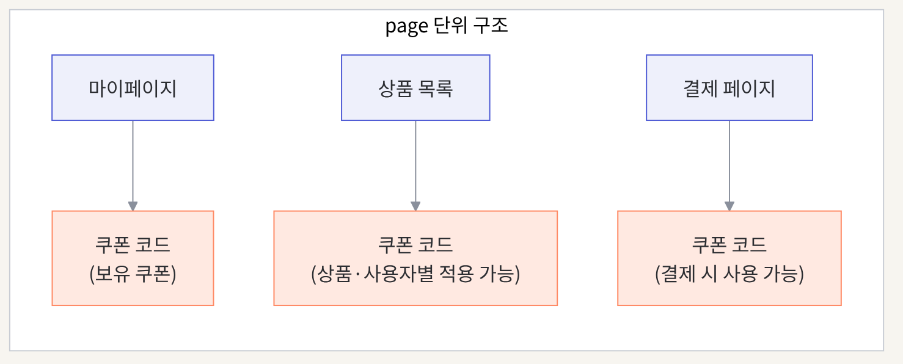
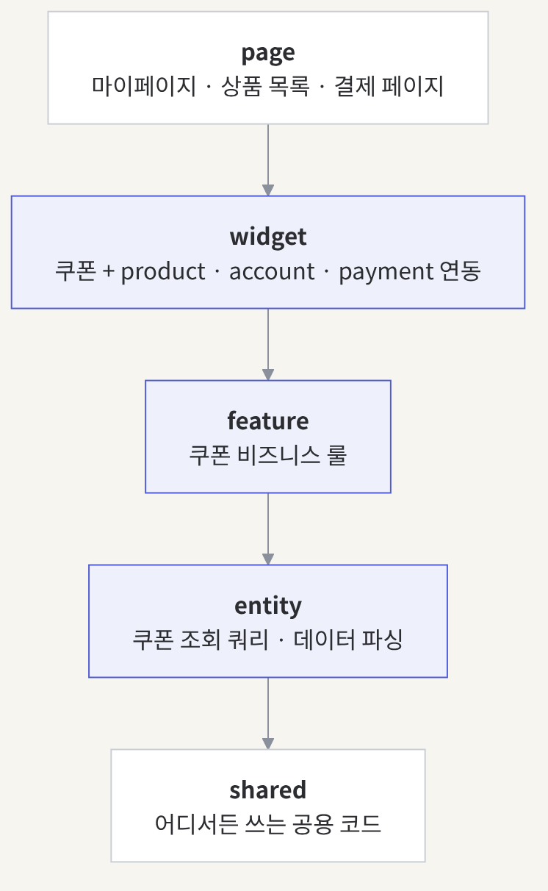

지난 편에서는 입사 두 달 만에 리뉴얼 프로젝트를 단독 FE로 맡게 된 배경을 이야기했어요.

**이번 편에서는 서비스별로 프레임워크를 나눈 이유와, 개발이 절반쯤 진행된 시점에 프로젝트 구조를 FSD로 바꾼 과정을 이야기해볼게요.**

## 1. 본 사이트는 Next.js, 어드민은 React로 나눴어요

React 기반으로 간다는 건 프로젝트 시작 전부터 정해져 있었어요. 그 안에서 고민해야 했던 건 어떤 서비스에 무엇을 쓸 것인가였어요.

리뉴얼하는 서비스는 B2C 온라인 교육 커머스라 SEO가 중요했어요. 수익과 직결된 상품 페이지가 검색에 잡히지 않으면 고객 유입부터 막히니까요. 그러다 보니 자연스럽게 서버 사이드 렌더링(SSR)을 잘 쓸 수 있는 Next.js로 정했어요.

하지만 어드민은 얘기가 달랐어요. 내부 운영자만 쓰는 비공개 도구라, 굳이 서버 영역까지 관심 범위를 넓혀서 얻을 게 없다고 판단했거든요. React로 가면 서버 비용이 따로 들지 않고, 구조가 단순하게 유지되니 신경 쓸 영역도 줄어들어요.

## 2. 처음엔 익숙한 구조로 시작했어요

프레임워크를 정하고, 개발에 들어가기 전에 파일 구조를 잡았어요. `pages`, `components`, `shared`. 가장 익숙한 구조였고, 처음엔 크게 이상할 게 없었어요.

그런데 기능이 추가되고 처음 기획보다 고려할 게 많아지면서, 구조가 어딘가 이상하다고 느끼기 시작했어요. 교육 안에 커머스가 얽혀 있었거든요. VOD를 수강하려면 수강권이 있어야 하고, 수강권은 다시 상품, 그리고 상품 안의 코스와 관계를 맺고, 여기에 만료 조건까지 붙었어요. 세부 도메인 룰이 정말 많았어요.

페이지 단위로 파일을 나누다 보니, 내용은 비슷한데 방식이 조금 다르다는 이유로 파일이 따로 생기고 중복 선언이 늘었어요. 코드는 서로 얽혀 있는데, 그 참조 관계가 눈에 잘 들어오지 않았어요.

제일 심했던 게 '쿠폰'이었어요.

쿠폰은 마이페이지에도, 상품 목록에도 보여줘야 해요. 상품 목록에서는 상품마다, 혹은 사용자마다 적용 가능한 쿠폰을 보여줘야 하고, 결제할 때는 사용 가능한 쿠폰만 보여줘야 해요. **페이지마다 쿠폰 관련 코드가 흩어지니까, 어디를 수정해야 하는지가 점점 불명확해졌어요.**

*페이지 단위 구조에서는 같은 쿠폰 코드가 페이지마다 조금씩 다르게 흩어졌어요.*

## 3. 도메인 단위로 나누는 FSD를 만났어요

그러다 FSD(Feature-Sliced Design)를 발견했어요.

FSD는 위 레이어가 아래 레이어만 가져다 쓰는 단방향 레이어 구조이고, 레이어마다 규칙이 뚜렷하며, 코드를 도메인 단위로 나눌 수 있어요. 페이지 단위 구조에서 잘 보이지 않던 흐름을, 도메인 단위로 파일 구조를 다시 잡으면 풀 수 있겠다 싶었어요. 구조는 이렇게 잡았어요.

- **`shared`** — 어디서든 쓸 수 있는 공용
- **`entity`** — 순수한 데이터를 가공하고 표현
- **`feature`** — 사용자와 데이터가 상호작용하는 비즈니스 로직
- **`widget`** — 여러 요소가 뭉쳐 재사용 가능한 단위
- **`page`** — 다 모여서 한 페이지

고민이었던 쿠폰을 예로 들면, Coupon이라는 도메인을 잡고 `entity`에는 쿠폰을 불러오는 순수한 쿼리와 데이터 파싱 정도만 넣었어요. 비즈니스 룰은 `feature`에 모아뒀고요. product, account, payment처럼 여러 도메인과 맞물려야 하는 부분은, 여러 도메인이 만나는 레이어인 `widget`으로 옮겼어요.

이제 import만 봐도 이 컴포넌트가 어떤 도메인을 쓰는지 보여요. 그리고 **마이페이지든 상품 목록이든 결제 페이지든, 같은 Coupon을 끌어다 쓰는 구조가 됐어요.**

*쿠폰 코드가 레이어별로 한 곳에 모이고, 페이지는 그걸 가져다 쓰기만 해요.*

## 4. 바꾸기 전에 안전망부터 깔았어요

하지만 구조를 바꾼다는 게 쉬운 결정은 아니었어요. 이미 개발이 절반 정도 진행된 상태라, 잘못 건드리면 잘 돌아가던 기능이 갑자기 안 될 수 있었어요. 깨진 지점을 찾느라 오히려 시간을 더 써버릴 수도 있었고요.

그래서 **Playwright로 E2E 테스트를 먼저 작성해 안전망을 깔았어요.**

### 렌더링과 빌드만 확인하는 E2E 테스트

E2E 테스트는 보통 사용자 흐름 전체를 검증할 때 써요. 이번엔 조금 다르게 썼어요. 목표가 파일 구조를 바꾸면서 깨지는 곳을 최소화하는 거였으니까요.

구조를 바꿀 때는 로직이 틀어지기보다 import가 깨지는 경우가 대부분이고, 그러면 섹션 자체가 뜨지 않거든요. 그래서 각 섹션이 잘 렌더링되는지, 빌드가 잘 되는지만 확인하는 수준으로 범위를 좁혔어요.

목적이 명확하니 이 정도 테스트 코드는 AI가 빠르게 짜줄 수 있었어요. 무작정 맡기는 게 아니라, AI를 어디에 쓸 수 있는지 먼저 파악하고 가장 효과적인 지점을 찾으려고 했어요.

> 테스트의 목적을 좁히니, AI에게 맡길 수 있는 일이 분명해졌어요.

### 코드 에이전트에 리팩토링 순서를 정해줬어요

AI 코드 에이전트에는 룰을 만들어서, 리팩토링할 때 이 순서대로 움직이게 했어요.

1. 현재 페이지 기준 섹션별 렌더링 테스트 작성
2. 구조 수정
3. 기존 테스트 통과 여부 검증
4. 실패하면 수정
5. 2번 이상 실패하면 저한테 알림

실제로 import 문이 바뀌지 않은 채 넘어가서 섹션이 안 뜨는 경우를 잡아냈어요. 코드 에이전트로 리팩토링하는 중에, 많지는 않지만 수정이 누락되는 부분이 종종 있었거든요. **테스트가 없었다면 QA나 배포 뒤에야 알았을 문제를 미리 잡아낸 셈이에요.**

## 5. 기준이 생겼고, 새로운 고민도 생겼어요

페이지 단위 구조에서 도메인 단위 구조로 바꾸고 나니 체감이 확실히 달랐어요. **어떤 기능을 수정할 때 어디를 봐야 하는지 명확해졌고, 새 기능이 추가될 때도 어느 레이어, 어느 도메인에 넣어야 하는지 기준이 생겼어요.**

물론 새로운 고민도 생겼어요. 새 기능이 들어올 때마다 이게 이 도메인이 맞나, 여기 두는 게 최선일까, 도메인을 더 나눠야 하나 같은 질문이 따라왔어요. 그런데 이건 귀찮은 일이라기보다, 더 나은 서비스를 만들어가는 기반이라고 생각해요. 파일 위치 하나를 고민하다 보면 DB 구조나 서버 관점까지 생각이 닿게 되거든요. 어쩌면 마이크로서비스를 조금씩 익혀나가는 걸음이 아닐까 싶기도 하고요.

저는 제 페인 포인트 때문에 FSD를 선택했지만, 이게 꼭 정답은 아닐 거예요. 비즈니스와 가장 잘 어울리는 구조가 무엇인지 계속 고민해야 한다고 생각해요.

> 정답인 구조보다, 지금 비즈니스와 가장 잘 맞는 구조를 찾는 게 중요했어요.

지금 기능 하나를 고칠 때, 몇 개의 폴더를 열어야 하나요? 그 숫자가 구조를 다시 볼 때가 됐다는 신호일 수도 있어요.

구조를 잡았으니, 이제 이 코드를 사용자에게 내보내야 했어요. 다음 편에서는 서버가 뭔지부터 다시 생각해야 했던 배포 이야기를 해볼게요.
