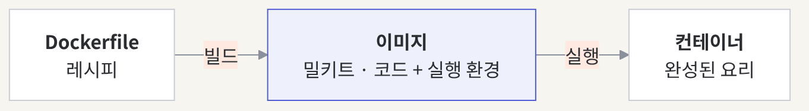
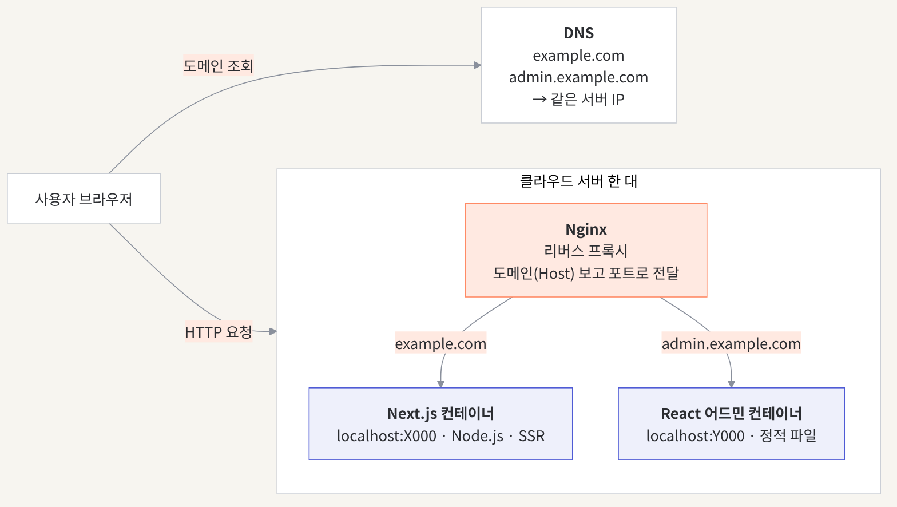

지난 편에서는 서비스별로 프레임워크를 나누고, 개발 중반에 FSD로 구조를 다시 잡은 이야기를 했어요.

**이번 편에서는 PM2로 급하게 띄운 첫 배포에서 Docker와 Nginx로 넘어가기까지, FE 코드가 사용자에게 닿는 흐름을 따라가 볼게요.**

개발을 이어나가면서 크고 작은 구현 고민들이 계속 따라왔어요. 번들 사이즈, 데이터 패칭 전략, 컴포넌트 분리와 추상화. 이런 것들은 익숙한 영역이라 부딪히면서 풀어나갈 수 있었어요. 사실 제일 쉬운 건 코드를 짜는 순간이라는 말이 있잖아요.

그런데 배포 시즌이 다가오면서 전혀 다른 종류의 막막함이 찾아왔어요.

사이드 프로젝트에서는 Vercel로 간단하게 배포했고, 이전에는 배포를 BE에서 담당해서 크게 신경 쓰지 않았어요. 부끄러운 이야기지만, 배포가 실제로 어떻게 동작하는지 잘 몰랐던 것 같아요. 하지만 이번엔 그럴 수 없었어요. 직접 서버를 세팅해야 했거든요.

그래서 서버가 뭔지부터 다시 생각해봤어요.

## 1. 서버란 뭘까요

추상적으로는 알고 있었어요. 우리가 작성한 코드를 어딘가에 올리면, 사용자들이 URL로 요청을 보내고, 그 요청에 대한 응답을 받는다. 그런데 그 "어딘가"가 구체적으로 뭔지, 어떻게 다루는 건지는 몰랐어요.

서버는 결국 꺼지지 않는 가상의 컴퓨터예요. 클라우드에서 필요한 스펙으로 컴퓨터 한 대를 빌리고, 거기에 코드를 올려두는 거예요. 사용자들은 그 컴퓨터를 가리키는 주소, 즉 URL로 요청을 보내는 거고요.

개념은 단순해요. 문제는 그 컴퓨터에 코드를 어떻게 올리느냐였어요.

## 2. 일단 PM2로 띄웠어요

처음엔 Docker까지 갈 여유가 없었어요. BE 개발자분과 둘 다 개발에 바빠서, 일단 코드를 서버에 올리고 띄우는 게 먼저였어요.

로컬에서 개발할 때는 `npm run dev`로 페이지를 띄우잖아요. 그런데 이 프로세스는 터미널을 닫으면 같이 꺼져요. 서버에서도 똑같이 하면 안 되겠죠. 그래서 `npm run build`로 빌드한 뒤 `npm run start`로 프로덕션 서버를 띄우고, PM2로 이 프로세스가 꺼지지 않게 관리했어요. PM2는 Node.js 프로세스를 감시하다가 죽으면 자동으로 다시 살려주는 도구예요.

다만 이 방식에는 위험 변수가 있었어요. 제 맥북 환경과 서버 환경이 다르니까요. Node.js 버전이 다를 수도 있고, 설치된 패키지가 다를 수도 있어요. **로컬에서 잘 돌아가던 코드가 서버에서 갑자기 안 될 수 있는 거예요.** 급해서 그 위험을 안고 갔지만, 오래 갈 방식은 아니었어요.

> 로컬에서 잘 돌던 코드가 서버에서도 잘 돈다는 보장은 없었어요.

그래서 Docker로 넘어갔어요.

## 3. Docker: 밀키트처럼 통째로 묶어서 올려요

Docker는 코드만 올리는 게 아니라, 코드가 실행되는 환경까지 통째로 묶어서 올리는 방식이에요. 밀키트처럼요. 재료와 조리법이 같이 들어 있으니까 어디서 만들어도 똑같이 나와요. 이 묶음(밀키트)을 이미지라고 하고, 이미지를 실행한 것(요리)을 컨테이너라고 해요.

이미지를 만들려면 `Dockerfile`이 필요해요. 밀키트를 만들기 위한 레시피 파일이에요. 이 환경에 무엇을 넣을지를 여기서 정해요.



*Dockerfile로 이미지를 만들고, 이미지를 실행하면 컨테이너가 돼요.*

### Next.js와 React는 묶는 방식이 달라요

그럼 어떻게 묶어서 올려야 할까요?

지금 FE 스택에는 Next.js와 React가 함께 있어요. 둘 다 React 기반이지만 `Dockerfile` 구성은 달라요. **서버가 필요한지 아닌지가 다르기 때문이에요.**

React SPA는 빌드하고 나면 정적 파일이에요. 사용자가 요청하면 이미 빌드된 정적 파일을 보내주는 게 전부예요. 그래서 `Dockerfile`을 두 단계로 나눠요. 빌드 단계에서는 Node.js로 정적 파일을 만들고, 실제로 실행할 최종 이미지에는 Node.js를 빼고 정적 파일과 그 파일을 보내줄 가벼운 웹 서버만 담아요. 이렇게 단계를 나눠 빌드하는 걸 멀티 스테이지 빌드(multi-stage build)라고 해요.

Next.js는 달라요. SSR을 쓰니까 요청이 올 때마다 서버에서 HTML을 그려서 보내줘야 해요. 이 작업은 Node.js 환경에서 일어나고요. 그래서 최종 이미지에도 Node.js가 들어가고, 그 컨테이너가 항상 살아 있어야 해요.

흔히 "FE 서버가 필요하다, 아니다"라고 말하는 지점이 바로 여기예요.

- **React SPA** → 빌드할 때만 Node.js 사용. 최종 이미지에는 Node.js 없음. 정적 파일 서빙만
- **Next.js** → 최종 이미지에도 Node.js 포함. 요청마다 HTML 생성. Node.js 컨테이너 상시 필요

두 `Dockerfile`을 나란히 놓고 보면 차이가 바로 보여요. 구조를 보여주기 위한 예시 코드예요.

```dockerfile
# Next.js: 최종 이미지에도 Node.js가 필요해요
FROM node:20-alpine AS build
WORKDIR /app
COPY package*.json ./
RUN npm ci
COPY . .
RUN npm run build

FROM node:20-alpine
WORKDIR /app
COPY --from=build /app ./
EXPOSE X000
CMD ["npm", "run", "start"]
```

```dockerfile
# React SPA: Node.js는 빌드할 때만 써요
FROM node:20-alpine AS build
WORKDIR /app
COPY package*.json ./
RUN npm ci
COPY . .
RUN npm run build

FROM nginx:alpine
COPY --from=build /app/dist /usr/share/nginx/html
EXPOSE 80
```

두 파일 모두 첫 단계(`AS build`)는 같아요. 차이는 마지막 단계에서 무엇을 기반으로 하느냐예요. Next.js는 `node` 이미지 위에서 `npm run start`로 서버를 띄우고, React는 빌드 결과물만 Node.js가 없는 웹 서버 이미지로 옮겨 담아요.

### 서버 사양도 달라져요

그럼 클라우드에서 빌린 가상 컴퓨터는 어떻게 될까요? React SPA만 배포한다면 그 컴퓨터가 필요 없는 걸까요?

파일을 올려둘 곳은 어떤 경우든 필요해요. 다만 React SPA라면 그곳이 하는 일이 훨씬 단순해요. 연산이 거의 없으니 사양이 낮아도 되고, Vercel이나 S3 같은 정적 파일 호스팅 서비스를 쓰면 서버를 아예 빌리지 않아도 돼요. 지난 편에서 어드민을 React로 정한 이유 중 하나가 서버 비용이었는데, 여기까지 보면 그 이유가 더 분명해져요.

반면 Next.js는 요청마다 Node.js가 HTML을 만들어야 하니까 연산이 필요하고, 그 연산을 할 서버가 항상 살아 있어야 해요. 그래서 가상 컴퓨터가 반드시 필요하고, 사양도 어느 정도 돼야 해요.

이렇게 만든 두 이미지를 클라우드 서버에 올렸어요. 저희 상황에서는 서버를 각각 둘 필요가 없다고 판단해서, 두 이미지를 한 서버에 함께 올렸어요.

## 4. 그럼 요청은 어떻게 흘러갈까요

Next.js와 React 어드민을 한 서버에서 운영하면, 서버 안에는 프로젝트마다 컨테이너가 하나씩, 여러 개가 떠 있어요. 실제로 한 서버에 이런 프로젝트가 5개 정도 올라가 있어요. 그럼 들어온 요청이 어느 컨테이너로 가야 하는지는 어떻게 알 수 있을까요?

도메인이 다르겠죠. `example.com`은 Next.js, `admin.example.com`은 React 어드민. 그런데 DNS에서 두 도메인이 같은 서버 IP를 가리키고 있으면, 요청은 결국 같은 서버로 도착해요. 도메인은 달라도 도착하는 곳은 같은 거예요.

두 컨테이너는 같은 서버 안에 떠 있고, 각자 서버의 포트 하나씩에 연결돼 있어요. Next.js는 X000번, React 어드민은 Y000번이에요. (포트 번호는 예시예요) 외부에서 보면 도메인이 다른 두 서비스지만, 서버 안에서 보면 둘 다 localhost이고 포트 번호로만 구분되는 거예요. 실제 설정에서도 포트를 `127.0.0.1:X000:X000`처럼 서버 안(localhost)에만 열어두어서, 바깥에서는 컨테이너에 바로 닿을 수 없어요. 그래서 같은 서버로 도착한 요청을 보고 "이건 어느 포트로 가야 하는지"를 판단해줄 누군가가 필요해요.

그 역할을 Nginx가 해요. HTTP 요청 헤더(Host)에는 사용자가 어떤 도메인으로 들어왔는지가 담겨 있어요. **Nginx는 이 도메인을 보고 "`example.com`은 X000번 포트로, `admin.example.com`은 Y000번 포트로" 하고 해당 컨테이너로 요청을 넘겨줘요.** 이렇게 앞에서 요청을 받아 뒤의 서버로 나눠주는 걸 리버스 프록시(reverse proxy)라고 해요.

Nginx 설정으로 보면 이렇게 생겼어요. 이것도 구조를 보여주기 위한 예시예요.

```nginx
server {
  server_name example.com;
  location / { proxy_pass http://localhost:X000; }
}

server {
  server_name admin.example.com;
  location / { proxy_pass http://localhost:Y000; }
}
```

`server_name`이 요청의 도메인을 보는 부분이고, `proxy_pass`가 그 요청을 넘길 포트예요. 판단 기준은 도메인이고, 도착지는 포트인 셈이에요.

그렇게 안내받은 컨테이너가 화면을 그리는 데 필요한 리소스를 응답으로 돌려보내줘요. 사용자는 그걸 받아서 브라우저에 화면을 띄우는 거고요.



*두 도메인은 같은 서버로 도착하고, Nginx가 도메인을 보고 각 컨테이너로 나눠 보내요.*

## 5. 내 코드가 사용자에게 닿기까지

이게 FE 코드가 실제로 살아서 동작하는 흐름이에요. 막연하게 "배포는 DevOps가 하는 것"이라고 생각했던 영역인데, 직접 해보고 나니 제가 짠 코드가 어떻게 사용자에게 닿는지 비로소 이해하게 됐어요. 전에는 FE와 BE 사이만 보였다면, 이제는 클라이언트에서 서버까지 이어지는 흐름이 보여요.

> 배포는 남의 영역이 아니라, 제 코드가 사용자에게 닿는 마지막 구간이었어요.

요청이 서버까지 닿는 흐름을 알게 됐으니, 다음은 그 뒤에서 데이터를 주고받는 API와 DB 차례였어요. 다음 편에서는 API 에러를 직접 추적하다 DB 테이블을 들여다보게 된 이야기를 해볼게요.
