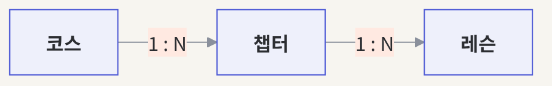

지난 편에서는 PM2에서 Docker와 Nginx로 넘어가며, FE 코드가 서버를 거쳐 사용자에게 닿는 흐름을 따라가 봤어요.

**이번 편에서는 API 에러를 직접 추적하다 DB 테이블을 읽게 되고, 그 덕분에 기획, API, 어드민 화면까지 달라진 이야기를 해볼게요.**

마감이 빠듯해서 빠르게 진행해야 했는데, 테이블 설계부터 구현까지 해야 할 일이 너무 많았어요. 정신없이 진행되다 보니 미처 발견하지 못한 실수로 API에서 에러가 났는데, BE 쪽은 테이블 설계와 마이그레이션, 기존 서비스 대응까지 맡고 있어서 그걸 고칠 여유가 없었어요. FE라고 이런 상황에 손가락만 빨고 있을 수는 없으니까 직접 확인해보기로 했어요.

어떤 API가 문제인지, 그 API는 어떤 테이블을 보고 어떤 로직으로 구성되어 있는지를 파악했어요. 다행히 BE도 같은 모노레포 안에서 NestJS, 즉 TypeScript로 작성되어 있어서 코드를 읽는 데 어렵지 않았어요. 학부 때 DB 수업을 들었던 것도 도움이 됐고요.

그렇게 DB 테이블을 직접 들여다보기 시작했어요.

## 1. 테이블이 읽히기 시작했어요

기본적인 테이블 구조는 그때 배운 덕분에 이해가 됐어요. 하지만 실무 도메인이 세세하게 얽히니 쉽지 않은 부분도 있었어요. 특히 커머스 도메인의 상품, 상품 패키지, 상품 아이템처럼 N:M 관계를 잇는 중간 테이블은 처음엔 좀 어렵게 느껴졌어요.

그래도 보다 보니 점점 감이 생겼어요. MCP 서버의 도움도 많이 받았어요. MariaDB에 MCP를 연결해두고, 테이블 구조가 어떻게 되어 있는지, 값이 잘 들어갔는지를 AI한테 물어보면서 확인했거든요. dev 환경에만 연결했지만, 테이블 구조를 다시 검사하고 데이터를 확인하는 데 꽤 든든한 도구였어요.

## 2. 기획의 롤까지 보게 됐어요

기획이 넘어오는 방식이 매끄럽지 못했어요. 팀 안에 기획자라는 롤이 있다기보다는, 운영 측에서 필요한 요구사항을 전달하는 것에 가까웠거든요. "쿠폰이 있었으면 좋겠어요" 이런 식으로요.

그래서 거꾸로 질문하면서 이야기를 맞춰가야 했어요.

- 쿠폰은 왜 필요한가요?
- 쿠폰은 어떻게 사용할 수 있나요?
- 쿠폰을 사용한 결제건은 사용자가 직접 환불하지 못해야 할까요?

이런 식으로 비즈니스까지 같이 살피게 됐어요. 질문을 드리면 요구사항을 말씀해주신 쪽에서도 쉽게 결정하지 못할 때가 있었어요. 그럴 때는 "이렇게 하면 공수가 크지만 이런 처리가 가능하고, 저렇게 하면 공수가 작지만 이런 제약이 있어요. 의도가 어떻게 되냐에 따라 방향이 달라져요"처럼, 선택지마다 장단점과 다음 단계를 같이 이야기했어요.

**사실 이런 대화는 DB 구조를 알고 있으니까 가능했어요.** 새 기능이 어느 테이블과 연관되는지 보이니까, 기존 기능 중에서 영향을 받을 부분도 자연스럽게 머릿속에 떠올랐거든요. 그게 없었다면 다 만들고 나서 "아, 여기서도 영향이 있는데!" 싶은 순간이 많았을 거예요.

> 새 기능이 어느 테이블에 닿는지 보이면, 영향을 받을 기능도 같이 보여요.

## 3. API를 직접 짜기도 했어요

그중에서도 어드민 개발이 제일 빠듯했어요. 서비스와 어드민을 동시에 만들어야 하는데 테이블 설계도 새로 해야 해서, BE 한 명으로는 역부족이었어요.

그때는 테이블 구조가 머릿속에 있었으니, FE 직무이지만 API를 직접 짜기도 했어요. 강의를 구성하려면 코스, 챕터, 레슨이 순서대로 있어야 하고, 각 테이블의 속성으로 무엇을 create해야 하는지가 그려졌거든요.



*강의는 코스, 챕터, 레슨이 차례로 이어진 구조라, 테이블을 알면 만들어야 할 API가 그려졌어요.*

물론 그렇다고 바로 승인이 난 건 아니었어요. 코드 리뷰를 받고, 여러 테스트와 피드백을 거쳐 기능 QA까지 마쳤어요.

그리고 DB 구조를 알고 어드민을 다루다 보니, 제가 먼저 서비스의 DTO를 작성해서 BE 개발자분께 전달하고 피드백을 받는 방식으로 일할 수 있게 됐어요. 코스를 만드는 요청이라면 이런 모양이에요. 구조를 보여주기 위한 예시 코드예요.

```ts
// 코스 생성 요청 DTO (예시)
export class CreateCourseDto {
  @IsString()
  title: string;

  @ValidateNested({ each: true })
  @Type(() => CreateChapterDto)
  chapters: CreateChapterDto[];
}

export class CreateChapterDto {
  @IsString()
  title: string;

  @IsInt()
  order: number;

  @ValidateNested({ each: true })
  @Type(() => CreateLessonDto)
  lessons: CreateLessonDto[];
}

export class CreateLessonDto {
  @IsString()
  title: string;

  @IsInt()
  order: number;
}
```

코스 안에 챕터가, 챕터 안에 레슨이 순서대로 담기는 테이블 구조가 그대로 요청의 모양이 돼요. 이 초안을 두고 BE 개발자분과 피드백을 주고받았어요.

**BE → FE로 이어지던 기존 개발 순서를 조금 깨고, 개발 속도를 올릴 수 있었던 경험이에요.**

## 4. DB를 알면 화면이 달라져요

어드민에서 강의나 상품 같은 복잡한 데이터를 다루는 화면을 만들 때, 어떤 테이블들이 모여서 하나의 덩어리를 이루는지가 보이니까 고민의 방향이 달라졌어요.

상품 하나를 세팅하려면 정보가 꽤 많잖아요. **이 정보를 어떻게 배치해야 실제 데이터 구조와 운영자(비개발자)가 머릿속에 그리는 구조가 비슷하게 맞춰질지, 이 고민을 제일 열심히 했어요.**

개발자와 비개발자가 서로 생각을 맞추는 게 제일 어렵잖아요. 원하는 게 있어도 비개발자는 DB의 실상이나 데이터 구조를 이해하기 어려우니까요. 그 간극을 최대한 줄일 수 있는 배치, 단어 선택, 안내 문구를 고민했는데, DB를 알고 있으니 안내하기가 훨씬 쉬웠어요.

## 5. 화면 너머가 보이기 시작했어요

DB를 안다는 건 단순히 데이터를 읽을 수 있게 된 게 아니라, 서비스 전체의 흐름이 보이기 시작했다는 것이었어요. 기획을 구체화하고, 영향 범위를 파악하고, 화면을 설계하고, API를 짜는 것까지. 테이블 하나를 이해하는 게 그 모든 것과 연결되어 있었어요.

화면을 만드는 데 집중하던 시야가, 이 화면이 어떤 데이터로 이루어져 있고 그 데이터가 어떻게 흘러가는지까지 넓어졌어요. 화면 너머의 것들이 보이니까 자연스럽게 프로덕트 전체를 생각하게 되더라고요. 제가 만드는 게 단순히 UI가 아니라 하나의 서비스라는 감각이 생기는 경험이었어요.

> DB를 안다는 건 데이터를 읽는 게 아니라, 서비스의 흐름을 읽는 일이었어요.

DB를 알고 나니 요구사항에 질문을 던질 수 있게 됐어요. 그런데 요구사항 자체가 비어 있거나, 같은 단어를 서로 다르게 쓰고 있다면 어떨까요? 다음 편에서는 다른 직군과 같은 언어를 만들어간 이야기를 해볼게요.
