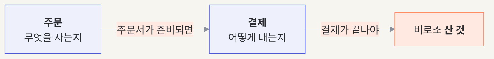

지난 편에서는 DB 테이블을 읽게 되면서 기획, API, 어드민 화면까지 달라진 이야기를 했어요.

**이번 편에서는 같은 단어를 서로 다르게 쓰던 문제를 공통 언어로 풀고, 비어 있는 요구사항을 구체화하며 먼저 제안하게 된 과정을 이야기해볼게요.**

개발자끼리는 말이 잘 통해요. 에러가 났다, 어떤 부분에서 문제가 있을 수 있다, DB상에서 어떻다 같은 전문 용어로 말하면 서로 원하는 바를 바로 알아들어요. 그런데 운영, 기획 같은 다른 직군과의 소통은 달라요. 같은 단어를 쓰는데 서로 다른 걸 떠올리는 일이 생기거든요.

## 1. 삭제가 삭제가 아닐 수 있어요

가장 기억에 남는 게 삭제, 수정 같은 부분이었어요.

"삭제 기능을 만들어주세요." 운영 입장에서는 당연히 요구할 수 있어요. 지우는 거고, 안 보이게 하는 거니까요. 그런데 서버팀에서는 "삭제는 없다. 삭제가 아니라 안 보이게 하는 거다. 안 보이게 하되 URL로는 접근 가능하게 하냐 아니냐다"라고 했어요. DB에서 데이터를 실제로 지우는 건 사실 쉽지 않거든요. 그래서 데이터는 남겨두고 삭제 표시만 해서 안 보이게 하는, 이른바 소프트 삭제(soft delete)를 써요. 서로 원하는 바는 같은데 부르는 이름이 달라서 의사소통이 어려웠던 일이었어요.

그때 중간에서 조심스럽게 이야기를 꺼냈어요.

"두 분이서 하시는 말씀이 같은데 다른 것 같아요. 요구하시는 삭제가 나타내는 기능은 결국 안 보이고 URL로 접근도 안 되는 것 아닌가요?"

**결국 원인은 같은 기능을 서로 다른 이름으로 부르는 데 있었어요.** 그리고 데이터나 상황에 따라 답이 달라지는 경우도 있었어요.

금액 수정도 그랬어요. "다른 가격에 팔 거니까 수정해달라"고 하면 서버팀에서는 "그건 안 된다, 기존에 산 사람들이 있지 않냐, 다시 상품을 만들어라"라고 했어요. 누군가는 15,000원에 샀는데 어느 날 그게 10,000원이 된다면 말이 안 되는 거잖아요. 정가는 그대로 두고, 프로모션이나 다른 개념으로 할인을 적용하는 구조가 되어야 해요. 그런데 운영 입장에서는 그냥 "사용자가 이 기간에 더 싼 값에 구매함"이라는 결과만 보일 뿐이에요. 여기서도 의사소통이 어려웠어요.

원하는 기능은 같거나 비슷한데, 서로의 상황을 이해하지 못해서 생기는 문제들이었어요. 어쩔 수 없는 부분도 있지만, 최대한 이 문제를 풀고 싶었어요.

## 2. 같이 부를 수 있는 언어를 먼저 만들었어요

이 경험 이후로, 새 기능을 만들 때는 먼저 언어를 맞추는 게 중요하다는 걸 알게 됐어요. 이 언어는 개발자끼리, 운영자끼리만 아는 게 아니라, 그 서비스와 관련된 사람이라면 모두가 알아야 해요. 도메인 주도 설계(DDD)에서 말하는 유비쿼터스 언어(ubiquitous language)와 같은 이야기예요.

같은 장면을 두고도, 책상이 다르면 단어가 달라져요. 주문·결제에서도 그게 분명히 보였어요.

깊게 따져보면 도메인에서는 `order`와 `payment`가 따로 있어요. `order`는 무엇을 사는지, 즉 주문서를 만드는 일을 책임지고, `payment`는 어떻게 돈을 받는지, 즉 PG 결제와 쿠폰에 관련된 일을 책임지는 도메인이에요.

*주문서가 준비되면 결제로 넘어가고, 결제가 끝나야 비로소 '산 것'이 돼요.*

그런데 order와 payment라는 말로 소통하면, 그 말에 익숙하지 않은 쪽에서는 이해하기 어려워요. 그래서 **주문**과 **결제**라는, 모두가 같이 부를 수 있는 이름을 붙였어요.

| 같이 부르는 말 | 코드에 가까운 말 |
| --- | --- |
| 주문 | `OrderSheet` (결제 전) |
| 결제 | `Payment`로 돈을 받는 과정 |
| 결제 완료 | `OrderSheet`가 `PAID` → 그다음 이행 |

주문은 했지만 결제를 안 하면 그건 아무것도 아닌 거잖아요. **이렇게 논리적인 레이어에서 개념을 맞추니, 서로 동상이몽하는 상황이 줄어들었어요.**

## 3. 모의고사를 만들어주세요

어느 날 이런 요구사항이 왔어요. "모의고사를 만들어달라."

간단한 디자인 시안 하나를 받은 그 순간, 머릿속을 스쳐 지나간 물음표가 한두 개가 아니었어요.

- 문제 유형은 어떤 것들이 있는지
- 채점은 어떻게 하는지
- 무료로만 제공하는지, 구매해서 푸는지
- 풀었던 기록은 어떻게 남는지
- 재응시는 어떤 기준인지

그래서 "이 기능이 어떤 의도로 필요한 건가요?"라고 물었어요.

상대방도 흠… 싶은 얼굴이었어요. 일정이 빠듯하게 시작된 프로젝트다 보니, 그런 부분까지 미리 정리가 안 된 상황이었으니까요.

그래서 제가 먼저 문서를 작성하기 시작했어요. 기획 논의에 좀 더 목소리를 내며 참여할 수 있게 된 때라, 문서에 히스토리를 남기는 것도 이때부터 제가 먼저 챙겼어요. 기능을 정하기 전에 이 네 가지를 먼저 적었어요.

- 왜 시작하게 됐는지
- 무엇을 위한 건지
- 타겟이 누구인지
- 어떤 결과를 내고 싶은지

이게 먼저 잡히니까, 이후 정책 논의에서 "이게 맞냐, 저게 맞냐" 고민하는 순간에도 목적과 타겟이 맞춰져 있었어요. 그래서 훨씬 빠르게 결정하고, 더 나은 선택을 할 수 있었어요.

> 무엇을 만들지보다, 왜 만드는지를 먼저 적었어요.

리텐션을 높이자, 결제 전환율을 높이자처럼 목표가 생기면 기획이 잡혀요. 가설을 세우고, 증명하고, 그걸 다음 비즈니스의 발판으로 삼는 흐름을 만들어가고 싶었어요.

## 4. 먼저 이야기를 꺼내게 됐어요

환급 신청 서비스를 리뉴얼하던 때예요. 예전에는 네이버 카페 환급 게시판에 신청 글을 올리면, 운영팀이 일일이 확인하고, 그 사람 이메일로 계정 정보를 찾고, 수강권이 있는지, 합격 후기를 썼는지 등을 확인한 뒤 환급해 주는 방식이었어요. 아주 복잡하고 손이 많이 가는 일이었죠.

이번에 환급 게시판 리뷰를 우리 서비스 안으로 가져오기로 했어요. 우리 사이트 방문자 수를 늘리자는 의도였어요. 그런데 그때 이런 생각이 들었어요. 이걸 운영팀이 일일이 처리하게 두기보다, 신청까지 사이트에 넣고 어드민에서 더 빠르게 확인할 수 있게 하자고요.

환급하려면 수강권 확인이 필요하잖아요. 그래서 먼저 이렇게 제안했어요. "환급 신청하는 부분에서 본인이 가진 수강권을 선택할 수 있는 단계를 추가하면 어떨까요? 그러면 운영 쪽에서 어드민만 보고 바로 확인할 수 있지 않을까요?"

**DB 구조를 알고, 운영 흐름을 알고, 비즈니스 맥락을 아니까 먼저 이런 이야기를 꺼낼 수 있었어요.** "이거 만들어주세요", "네" 하고 만들었는데 "어? 이거 이런 거 아닌데요"라는 말을 듣는 일이 거의 없어진 것도 그 덕분이에요.

단순히 요구사항을 받아서 구현하는 데서, 비즈니스를 같이 만들어 가는 쪽으로 역할이 넓어진 느낌이었어요.

> 요구사항을 받아 구현하는 사람에서, 비즈니스를 같이 만드는 사람이 되어가고 있었어요.

지금 만들고 있는 기능, 기획이나 운영과 같은 이름으로 부르고 있나요?

기능을 만들어 내보낸 다음에는 운영이 기다리고 있었어요. 다음 편에서는 결제에서 난 500 에러 하나를 서버 로그부터 따라간 이야기를 해볼게요.
