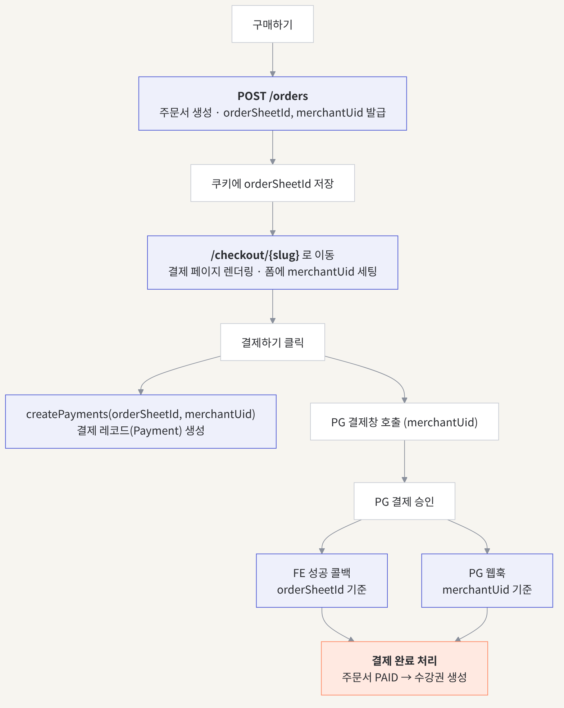

지난 편에서는 다른 직군과 같은 언어를 만들고, 비어 있는 요구사항을 구체화한 이야기를 했어요.

기능을 만드는 것과 운영하는 것은 다른 일이에요. 배포하면 끝인 줄 알았던 코드가 실제 사용자 손에서는 예상하지 못한 순서로 움직이거든요. 뒤로 가기를 누르고, 탭을 하나 더 열고, 결제 직전에 나갔다가 다시 들어와요. 그리고 그 결과는 대부분 에러 로그 한 줄로 찾아와요.

**이번 편은 결제 웹훅에서 난 500 에러 하나를 따라가며 원인을 찾고, 급한 불을 끄고, 두 달 뒤 같은 뿌리의 문제를 구조부터 다시 잡기까지의 이야기예요.**

## 1. 결제에서 500이 났어요

아침에 에러 알림 하나를 봤어요. 전날 밤 11시 59분에 온 알림이었어요.

```
(민감한 내용은 빼고 간략하게 옮겼어요)
Error Alert
Payment of orderTransactionId XXXXX not found

POST /payments/webhook
위치: 결제 웹훅 처리 → 결제 처리 로직

statusCode: 500
userAgent:  PG사 웹훅
timestamp:  (발생 시각)
```

보자마자 "헉" 했어요. 결제였거든요. 서비스에 돈을 벌어다 주는 코드에서 에러가 났다는 거고, 이것 때문에 사용자가 결제를 못 했거나 결제를 했는데 수강을 못 하고 있다면 그대로 손실이자 CS예요. 평소보다 일찍 출근해서 바로 들여다봤어요.

그런데 막막했어요. 에러 알림은 서버 **어디서** 터졌는지만 알려줄 뿐, **왜** 터졌는지는 알려주지 않았거든요. 사용자가 어떤 순서로 무엇을 하다가 이렇게 됐는지, 주문 트랜잭션의 어떤 값이 어디서 틀어졌는지 알 수 없었어요.

### 먼저, 결제는 이렇게 흘러가요

원인을 이야기하기 전에 당시 결제 흐름을 짚고 갈게요. 결제 한 번에는 서로 다른 값 세 개가 움직여요.

| 값       | 무엇인가                       | 어디에 있었나                  |
| ------------ | ---------------------------------- | ---------------------------------- |
| slug         | 상품을 구분하는 값                 | 결제 페이지 URL `/checkout/{slug}` |
| orderSheetId | 주문서 번호 (DB PK)                | 전역 쿠키 1개                      |
| merchantUid  | PG사에 넘기는 결제 고유번호       | 결제 폼, PG 결제창, 웹훅           |

merchantUid는 주문서가 만들어질 때 서버가 한 번 발급하는 값이고, 안에 주문서 번호가 인코딩되어 있어요. 그래서 서버는 웹훅으로 merchantUid만 받아도 어떤 주문서의 결제인지 역추적할 수 있어요.

정상적인 흐름은 이래요.


*결제 한 번에 쿠키, 폼, 웹훅의 값이 모두 같은 주문서를 가리키며 흘러가요.*

핵심은 하나예요. **쿠키의 orderSheetId, 폼의 merchantUid, 웹훅으로 돌아오는 merchantUid가 모두 같은 주문서를 가리켜야 해요.** 셋 중 하나라도 다른 주문서를 가리키면, 결제 레코드는 한 주문서에 생기고 결제 완료 신호는 다른 주문서로 가요.

에러 메시지 `Payment of orderTransactionId XXXXX not found`는 정확히 그 상황이었어요. 웹훅이 가리킨 주문서에 결제 레코드가 하나도 없었던 거예요.

## 2. 로그로 사용자의 6초를 되짚었어요

### 단서 하나에서 출발했어요

제가 가진 건 `orderTransactionId XXXXX`와 정확한 timestamp, 두 개뿐이었어요.

알림의 userAgent에서 보이듯 이 요청은 사용자가 아니라 PG사가 보낸 웹훅이에요. 요청 자체에는 사용자 정보가 없었어요. 그래서 먼저 "누가"를 찾아야 했어요.

추적은 이렇게 이어졌어요.

```
에러 알림
  │  orderTransactionId XXXXX, timestamp
  ▼
DB 조회
  │  해당 row → userId
  ▼
BE · FE 로그 파일
  │  timestamp 전후 + userId로 범위 축소
  ▼
AI 교차 분석
  │  BE 요청 로그 + FE 접근 로그를 시간순으로 합침
  ▼
사용자 행동 타임라인 재구성
```

#### DB: 주문으로 사람을 찾았어요

orderTransactionId로 DB에서 해당 row를 조회해서 userId를 얻었어요.

#### 로그: 통째로 주지 않고, 좁혀서 줬어요

다행히 BE와 FE 모두 로그를 남겨서 서버에 보관하고 있었어요. 파일을 내려받았는데 하루치가 쌓여 있었어요. 사람 눈으로 훑기도 어렵고, AI에게 통째로 넘기기엔 토큰이 너무 많이 들 것 같았어요.

그래서 범위를 좁혔어요. 정확한 시점과 사람이 이미 있었으니까요.

> "이 에러 원문과 시점을 기준으로, 이 userId가 그 전후에 어떤 요청을 보냈는지 BE 로그와 FE 로그를 같이 분석해 줘."

확실한 timestamp와 userId가 있으니 AI가 엉뚱한 곳을 뒤질 필요가 없었고, 답도 빨리 나왔어요. AI를 잘 쓰려면 결국 **무엇을 물을지 좁혀 줄 단서**를 사람이 쥐고 있어야 한다는 걸 느꼈어요.

### 로그가 말해준 것: 6초 만에 주문서가 두 개

재구성된 사용자 행동은 이랬어요. (KST 기준)

| 시각 | 로그                             | 해석                             |
| -------- | ------------------------------------ | ------------------------------------ |
| 23:57:50 | `POST /api/v1/orders` 성공           | 주문서 **A** 생성             |
| 23:57:50 | `/checkout/...` 진입                 | 결제 페이지 진입, 폼 merchantUid = A |
| 23:57:52 | `GET /?_rsc=...` (referer: checkout) | 결제 버튼을 누르지 않고 이탈         |
| 23:57:55 | 같은 상품 페이지 조회                | 다시 상품으로 돌아옴                 |
| 23:57:56 | `POST /api/v1/orders` 성공           | 주문서 **B** 생성             |
| 23:57:56 | `/checkout/...` 진입                 | 결제 페이지 진입                     |
| 23:59:41 | PG사 웹훅 `paid`                     | merchantUid가 **A**의 것            |
| 23:59:41 | 서버 500                             | A의 트랜잭션에 결제 레코드 없음      |

같은 사람이 같은 상품으로 **6초 만에 주문서를 두 개** 만들었어요. 결제 레코드는 B에 만들어졌는데, PG의 결제 완료 신호는 A로 왔어요.

"주문서가 두 개"라는 건 알았어요. 그런데 왜 A의 merchantUid로 결제가 됐는지는 아직 몰랐어요. 사용자는 분명 B의 결제 페이지에 있었거든요.

### AI는 가설을, 확인은 제가 했어요

"왜 이렇게 됐을까?"에 대해 AI가 가능한 시나리오를 몇 가지 제시했어요. 하지만 그걸 그대로 믿진 않았어요. AI가 말한 시나리오대로 직접 재현해 보고, 그 상황에서 코드가 정말 문제가 되는 방식으로 동작하는지 하나씩 검토했어요.

재현은 dev 환경에서 했어요. 여기서 server MCP가 요긴하게 쓰였어요. 원래는 "AI를 좀 더 잘 써보자" 하고 연결해 둔 거였는데, "이렇게도 되나?" 하고 시도해 보니 되더라고요. 재현할 때마다 주문서와 결제 레코드가 어떻게 쌓이는지 MCP로 바로 확인할 수 있었어요. MCP가 없었다면 매번 직접 쿼리를 짜서 DB를 들여다봐야 했을 거예요.

결제처럼 단계가 여러 개 이어지는 흐름은 **중간에 끊겼을 때** 어떤 상태가 남는지를 봐야 해요. 그래서 "결제 페이지 진입 → 이탈 → 같은 상품 재주문 → 다시 결제 페이지"처럼 중간에 끊기는 경로를 집중적으로 따라갔어요.

원인은 서버가 아니라 FE에 있었어요.

## 3. 원인은 FE에 있었어요

### 원인: 두 값이 서로 다른 시점에 읽혔어요

결제 버튼을 누를 때 쓰이는 두 값은 읽히는 위치도, 시점도 달랐어요.

| 값       | 어디서 읽었나 | 언제 읽었나                          |
| ------------ | ----------------- | ---------------------------------------- |
| orderSheetId | 전역 쿠키         | 매 렌더마다 (결제 클릭 시점의 최신 값)   |
| merchantUid  | 폼 defaultValues  | 결제 페이지가 **처음 마운트될 때 한 번** |

코드로 보면 이래요.

```tsx
// 1. 주문서 생성: 전역 쿠키 1개에 덮어쓰고, 상품 slug URL로 이동
setCookie(ORDER_SHEET_ID_KEY, orderSheetId, { path: "/" });
router.push(`/checkout/${slug}`);
```

```tsx
// 2. 결제 폼: merchantUid는 마운트 시 한 번만 세팅, 이후 갱신 없음
const methods = useForm({
  defaultValues: {
    merchantUid: orderSheetData?.merchantUid || "",
  },
});
```

```tsx
// 3. 결제 제출: orderSheetId는 쿠키에서, merchantUid는 폼에서
const orderSheetId = getCookie(ORDER_SHEET_ID_KEY);

const handlePaymentSubmit = async (data) => {
  await handleNormalPayment(data, Number(orderSheetId)); // data.merchantUid는 마운트 시점 값
};
```

```tsx
// 4. 결제 페이지 가드: 쿠키가 "있는지"만 확인
if (!getCookie(ORDER_SHEET_ID_KEY)) {
  window.location.reload();
}
```

문제는 URL이었어요. 결제 페이지는 `/checkout/{slug}`였고, slug는 상품의 값이에요. **같은 상품이면 주문서가 달라도 URL이 같았어요.**

같은 route로 다시 들어오면 Next.js는 결제 폼을 새로 마운트하지 않을 수 있어요. 브라우저 뒤로 가기나 bfcache로 이전 화면이 복원될 때도 마찬가지예요. 그러면 쿠키는 B로 바뀌었는데 폼은 여전히 A의 merchantUid를 들고 있게 돼요. 가드는 쿠키가 "있는지"만 봤으니 그대로 통과했고요.

그래서 이렇게 갈라졌어요.

```
23:57:50  주문서 A 생성
          쿠키 orderSheetId = A
          → /checkout/same-slug
          → 폼 마운트, merchantUid = A

23:57:52  이탈 (결제 안 함)
          A에는 결제 레코드 없음

23:57:56  주문서 B 생성
          쿠키 orderSheetId = B   ← A를 덮어씀
          → /checkout/same-slug   ← 같은 URL
          → 폼은 다시 마운트되지 않음, merchantUid = A 그대로

[결제하기 클릭]
          orderSheetId = B (쿠키)  ──▶ createPayments → 결제 레코드는 B에 생성
          merchantUid  = A (폼)    ──▶ PG 결제창    → PG사는 A로 결제 승인

23:59:41  웹훅(merchantUid = A, paid)
          → merchantUid 역추적 → 주문서 A
          → A의 트랜잭션에서 결제 레코드 조회 → 없음
          → 💥 500
```

에러 메시지만 보면 서버 에러였어요. 하지만 실제 원인은 FE의 **라우팅과 폼 상태의 생명주기**였어요. 서버는 받은 값대로 정직하게 동작했을 뿐이고, 어긋난 값을 보낸 건 FE였어요.

> 에러가 난 곳과 원인이 있는 곳은 달랐어요.

### 그래서 무엇이 남았나

원인을 찾은 다음에는 이 사용자에게 실제로 어떤 일이 있었는지 DB로 확인했어요. 당시 결제 완료 처리는 FE 성공 콜백과 웹훅, 두 갈래로 들어왔어요.




*같은 결제 승인이 FE 콜백에서는 B로, 웹훅에서는 A로 들어갔어요.*

| 시각 | 항목            | 결과                                |
| -------- | ------------------- | --------------------------------------- |
| 23:59:41 | PG 결제 승인        | A의 merchantUid로 승인, paid 웹훅 발송 |
| 23:59:41 | 웹훅 처리           | A 기준 → 결제 레코드 없음 → 500 실패    |
| 23:59:42 | FE 성공 콜백 처리   | B 기준 → 정상 처리, 주문서 B 결제 완료  |
| 23:59:42 | 수강권              | B 기준으로 정상 생성                    |
| 이후     | CS 문의 / 수동 조치 | 없음                                    |

웹훅이 실패한 지 1초 뒤, FE 콜백이 B 기준으로 결제를 완료 처리했고 같은 시각에 수강권도 생성됐어요. **사용자는 결제도, 수강권 지급도 정상적으로 받았어요.** 실패한 건 서버의 웹훅 처리 하나였고, 사용자가 겪는 결제·수강 흐름은 B 기준으로 성공했어요.

그래서 이번에는 다행히 피해가 없었어요. 하지만 운이 좋았던 거예요. 웹훅과 FE 콜백 두 갈래 중 하나가 살아 있어서 버틴 거지, 사용자가 결제 직후 창을 닫아 콜백이 유실됐다면 "결제했는데 수강이 안 돼요"가 됐을 거예요. 그리고 A는 PG에는 결제 승인 기록이 있는데 서비스에는 결제가 없는 주문서로 남았어요. 정산이나 환불 문의가 들어오면 바로 꼬일 수 있는 상태였어요.

그리고 하나 더 있었어요. 몇 초 차이로 같은 상품의 주문서가 계속 새로 만들어지는 건 DB에도 네트워크에도 아무 이점이 없는, 불필요한 비용이에요. 이번 에러가 아니었어도 줄여야 할 부분이었어요.

## 4. 급한 불을 끄고, 구조를 다시 잡았어요

### BE 개발자와 크로스 체크했어요

원인을 FE에서 찾았다고 FE만 고치면 끝나는 문제는 아니었어요. 결제는 FE, BE, PG가 같이 맞물려 돌아가는 흐름이니까요. 분석한 내용을 정리해서 BE 개발자와 이야기를 나눴어요.

> "파악한 원인은 이렇습니다. 같은 상품 재주문 시 쿠키의 주문서 번호와 폼의 merchantUid가 서로 다른 주문서를 가리키게 돼요. 이 외에 엣지 케이스가 있을 만한 부분은 없을까요?"

> "FE에서는 이런 방식으로 수정하려고 하는데, 이 방법에서 문제가 될 부분이나 피드백 주실 방향이 있을까요?"

서로의 방법을 크로스 체크했어요. FE에서 주문서를 구분하는 데 필요한 값을 응답 DTO에 더 담아달라고 요청하기도 하고, 한 번에 많은 일을 하던 API를 쪼개는 방안도 이야기했어요. "이렇게 고치자"를 넘어서 "그러려면 서버에서 무엇이 오고, 어느 레이어가 무엇을 책임질지"까지 구체적으로 맞춰 나갔어요.

### 1차 대응: 급한 불부터 껐어요

먼저 급한 불을 껐어요. 이전 주문서 번호가 쿠키에 남아 있다가 덮어쓰이는 상황을 줄이기 위해, 새 주문 전과 결제 완료 후에 쿠키를 지우도록 했어요.

```tsx
// 새 주문 전: 이전 주문서 번호 제거
deleteCookie(ORDER_SHEET_ID_KEY, { path: "/" });
setCookie(ORDER_SHEET_ID_KEY, newOrderSheetId, { path: "/" });

// 결제 완료 후: 남은 주문서 번호 제거
deleteCookie(ORDER_SHEET_ID_KEY, { path: "/" });
```

이걸로 "이탈 후 재주문" 상황에서 쿠키가 남아 꼬이는 경우는 줄었어요. 하지만 이건 증상 완화였어요. 구조는 그대로였거든요.

- 결제 페이지 URL은 여전히 상품 slug 기준이었고
- 주문서 번호는 여전히 전역 쿠키 하나였고
- 폼의 merchantUid는 여전히 마운트 시점 값이었어요

### 같은 뿌리, 다른 얼굴: 멀티탭

두 달쯤 지나 같은 뿌리의 문제가 다른 얼굴로 나타났어요. **멀티탭**이었어요. (아래 주문서 번호는 예시예요)

```
탭 A: 상품 A 결제 페이지 진입 → 쿠키 orderSheetId = 1001
탭 B: 상품 B 결제 페이지 진입 → 쿠키 orderSheetId = 1002  ← 덮어씀
탭 A: 결제 시도              → 쿠키에서 1002을 읽음 → 엉뚱한 주문서로 결제 시도
```

처음 에러는 "같은 탭에서 같은 상품을 다시 주문"할 때 터졌고, 이번에는 "서로 다른 탭이 쿠키 하나를 나눠 쓰면서" 터졌어요. 재현 조건은 달랐지만 뿌리는 같았어요. **주문서 번호를 전역 쿠키 하나에 두고, 주문서와 상관없는 값(slug)으로 결제 페이지를 구분하고 있었다**는 거예요.

1차 대응 때 쿠키를 지운 걸로는 이 경우를 막을 수 없었어요. 두 탭 모두 살아 있는 결제 페이지였으니까요.

### 고친 PR을 닫았어요

처음에는 slug 기준으로 쿠키를 매핑하는 방식으로 고치려고 PR을 올렸어요. 상품마다 주문서 번호를 따로 저장하면 탭 간 충돌은 막을 수 있으니까요.

그런데 결국 merge하지 않고 닫았어요. 닫으면서 남긴 이유는 이랬어요.

> orderSheet 관련해서 slug 값을 활용하는 건 의미 level에서 맞지 않음.
> checkoutId 등 다른 값으로 활용 필요.
> hotfix가 아닌 feature 브랜치로 생성 후 진행 예정.

**slug는 상품의 것**이에요. 주문서를 구분하는 데 쓰면 안 되는 값이었어요. slug로 매핑하면 탭 충돌은 막을 수 있어도, 같은 상품을 두 탭에서 결제하는 순간 다시 같은 문제가 생겨요. 처음 에러처럼요.

동작은 하지만 의미가 틀린 값 위에 또 하나의 땜질을 쌓는 대신, 핫픽스가 아니라 feature 브랜치를 따서 구조를 다시 잡기로 했어요.

### 구조를 다시 잡았어요

핵심은 **결제 시도 하나마다 고유한 값(checkoutId)을 두고, URL·쿠키·제출을 전부 그 값에 묶는 것**이었어요.

**전: 상품 기준, 전역 쿠키 하나**

```
/checkout/{slug}
        │
        ▼
cookie: orderSheetId = 1002      ← 탭이 몇 개든, 주문이 몇 번이든 하나
        │
        ▼
폼 merchantUid = 마운트 시점 값    ← 쿠키와 다른 주문서를 가리킬 수 있음
```

**후: 결제 시도 기준, checkoutId별 매핑**

```
/checkout/{checkoutId-A}  ─┐
/checkout/{checkoutId-B}  ─┤
                           ▼
cookie: pendingCheckouts = {
  "checkoutId-A": { orderSheetId: 1001 },
  "checkoutId-B": { orderSheetId: 1002 }
}
                           │
                           ▼
결제 클릭 시 URL의 checkoutId로 주문서 번호를 다시 조회
→ 매핑이 없으면 결제를 막고 새로고침
→ 결제 완료 시 해당 checkoutId 매핑 삭제
```

결제 제출 코드는 이렇게 바뀌었어요.

```tsx
const handlePaymentSubmit = async (data) => {
  const currentOrderSheetId = checkoutId
    ? getPendingOrderSheetIdByCheckoutId(checkoutId)
    : undefined;

  if (!checkoutId || !currentOrderSheetId) {
    setToastInfo("주문서 정보가 만료되었습니다.");
    router.refresh();
    return;
  }

  await handleNormalPayment(data, Number(currentOrderSheetId));
};
```

정리하면 이래요.

| 바꾼 것         | 전                             | 후                                        |
| ------------------- | ---------------------------------- | --------------------------------------------- |
| 결제 페이지 URL     | `/checkout/{slug}` (상품마다 같음) | `/checkout/{checkoutId}` (결제 시도마다 고유) |
| 주문서 번호 저장    | 전역 쿠키 1개                      | checkoutId → orderSheetId 매핑                |
| 결제 시 주문서 확인 | 렌더 시점 쿠키 값                  | 제출 시점에 checkoutId로 다시 조회            |
| 결제 페이지 가드    | 쿠키 존재 여부만 확인              | 매핑이 없으면 refresh                         |
| 결제 완료 후        | 쿠키 그대로 (1차 대응 이후 삭제)   | 해당 checkoutId 매핑만 삭제                   |

URL이 결제 시도마다 달라지니, 같은 상품을 다시 주문해도 다른 route가 되고 폼도 새 주문서 기준으로 다시 그려져요. 탭이 여러 개여도 각 탭은 자기 checkoutId의 주문서만 봐요.

서버도 같이 바뀌었어요.

| 단계 | 내용                                                   | 담당  |
| -------- | ---------------------------------------------------------- | --------- |
| 1차 대응 | 1차 대응: 주문서 번호 쿠키 삭제                            | 저 (FE)   |
| 구조 개선 | checkoutId 기반 URL, 쿠키 매핑, 제출 시 재조회             | 저 (FE)   |
| 구조 개선 | 주문 생성 응답에 checkoutId 추가                           | BE 개발자 |
| 구조 개선 (후속) | 결제 레코드 중복 적재 방지, 결제 전 주문서만 checkout 허용 | BE 개발자 |

BE 개발자가 결제 요청이 중복으로 들어오면 기존 대기 중인 결제 레코드를 실패 처리한 뒤 새로 만들도록 바꿨어요. 결제 전(ORDERED) 상태인 주문서로만 결제 페이지를 조회할 수 있게 제한하기도 했고요. 덕분에 이미 결제가 끝난 주문서로 결제 페이지에 다시 들어오는 경로도 서버에서 막혔어요.

FE에서 잘못된 값이 넘어가지 않도록 막고, BE에서 잘못된 값이 넘어와도 버티도록 막았어요. 한쪽만 막으면 다른 쪽에서 또 새어 나오니까요.

### 아직 남아 있는 것

다 막힌 건 아니에요. 지금도 폼의 merchantUid는 마운트 시점에 한 번만 세팅되고, 결제 제출 직전에 "주문서의 merchantUid와 폼의 merchantUid가 같은지" 검증하는 로직은 없어요.

다만 checkoutId 구조 덕분에 URL, 쿠키, 폼이 같은 결제 시도에 묶여 있어서 처음 에러처럼 "쿠키는 B, 폼은 A"가 되는 경로는 구조적으로 막혀 있어요. 남은 건 제출 직전에 세 값의 일치를 한 번 더 확인하는 방어선이에요. 다음에 손볼 목록에 올려두었어요.

## 5. 디버깅하면서 얻은 것

돌아보면 이번 디버깅은 이런 순서였어요.

```
1. 단서 확보      에러 알림 → orderTransactionId, timestamp
2. 사람 특정      DB → userId
3. 범위 축소      시점 + 사람으로 로그를 좁힘
4. 흐름 재구성    AI로 BE·FE 로그 교차 분석 → 타임라인
5. 가설 검증      AI가 제시한 시나리오를 dev에서 재현(MCP로 DB 확인)하고 코드로 확인
6. 원인 확정      FE 상태 생명주기 문제
7. 크로스 체크    BE와 원인·수정 방향·엣지 케이스 검토
8. 완화 → 근본    1차 대응 후, 같은 뿌리의 문제를 구조로 해결
```

여기서 몇 가지를 배웠어요.

**로그는 사고가 나기 전에 쌓아둬야 해요.** BE와 FE 모두 로그를 남기고 있었기 때문에 사용자의 행동을 초 단위로 되짚을 수 있었어요. 로그가 없었다면 "왜"는 영영 추측으로 남았을 거예요.

**AI에게는 좁혀서 줘야 해요.** 하루치 로그를 통째로 던지는 것보다, 시점과 사람으로 범위를 좁혀서 주는 게 빠르고 정확했어요. 그 범위를 정하는 건 사람의 몫이었어요.

**AI의 답은 가설이에요.** AI가 제시한 시나리오는 출발점이었지, 결론이 아니었어요. 직접 재현하고 코드로 확인하고 나서야 원인이라고 말할 수 있었어요. 프롤로그에서 "AI는 답을 대신 찾아주는 도구라기보다, 제가 이해한 게 맞는지 확인해주는 상대"라고 했던 게 이런 의미였어요.

**완화와 해결은 달라요.** 쿠키를 지운 1차 대응은 필요했어요. 하지만 그건 증상을 줄였을 뿐이라 두 달 뒤 같은 뿌리가 다른 모습으로 다시 나왔어요. 급한 불을 끈 뒤에는 "이게 근본 원인을 없앤 건가, 증상만 덮은 건가"를 따로 물어야 해요.

### 무엇을, 왜 구분하는지가 값을 정해요

이 일로 가장 크게 남은 건 이거예요. **구분할 수 있는 값이라고 해서 아무 값이나 쓰면 안 된다**는 거예요. 무엇을, 무엇 때문에 구분하는지에 따라 써야 할 값이 달라져요.

| 구분하려는 대상 | 써야 할 값 | 이유                         |
| ------------------- | -------------- | -------------------------------- |
| 어떤 상품인가       | slug           | 상품마다 하나                    |
| 어떤 주문서인가     | orderSheetId   | 주문할 때마다 하나               |
| 어떤 결제 시도인가  | checkoutId     | 결제 페이지에 들어갈 때마다 하나 |

slug로도 결제 페이지는 잘 열렸어요. 하지만 그건 "한 사람이 한 상품을 한 탭에서 한 번만 주문할 때"만 우연히 맞는 값이었어요. 이걸 알아채려면 화면이나 API만이 아니라 도메인과 테이블, entity에 대한 이해가 필요했어요. 상품, 주문서, 결제가 각각 무엇이고, 어떤 값이 어느 레벨에 속하는지를요.

원인을 찾는 과정도, 고치는 과정도 결국 그 이해를 쌓는 과정이었어요. 서버에서 어떤 속성을 더 받아와야 하는지, API를 어떻게 나눌지, 어느 레이어가 무엇을 책임질지를 BE와 함께 정하면서 도메인과 값의 관계를 하나씩 맞춰 나갔어요. 5편에서 이야기한 "같이 부를 수 있는 언어"가 사람 사이의 문제였다면, 이번에는 그게 **코드 안의 값**에서도 똑같이 중요하다는 걸 배웠어요.

결제처럼 단계가 있는 흐름을 볼 때도 관점이 바뀌었어요. 사용자는 언제든 중간에 이탈하고, 뒤로 가고, 탭을 하나 더 열어요. 그래서 이제는 기능을 만들 때 이것부터 따져봐요.

- 각 단계가 끝까지 **같은 대상**을 가리키고 있는가
- 그 값은 **언제** 읽히는가 (마운트 시점인지, 제출 시점인지)
- 중간에 끊기면 **무엇이 남는가**
- 같은 단계에 **다시 들어오면** 어떻게 되는가

에러 로그 한 줄에서 출발해 DB, 서버 로그, FE 코드, 도메인까지 따라갔어요. 그리고 고치는 과정에서 BE와 함께 값과 책임의 경계를 다시 그었어요.

화면을 만드는 사람에서, 서비스가 어떻게 흘러가는지 읽는 사람으로 한 걸음 넓어진 느낌이었어요.

마지막 편에서는 이 경험들이 저에게 무엇을 남겼는지, 그리고 AI와 함께 일하는 지금 어떤 마음가짐으로 일하고 있는지 이야기해볼게요.
