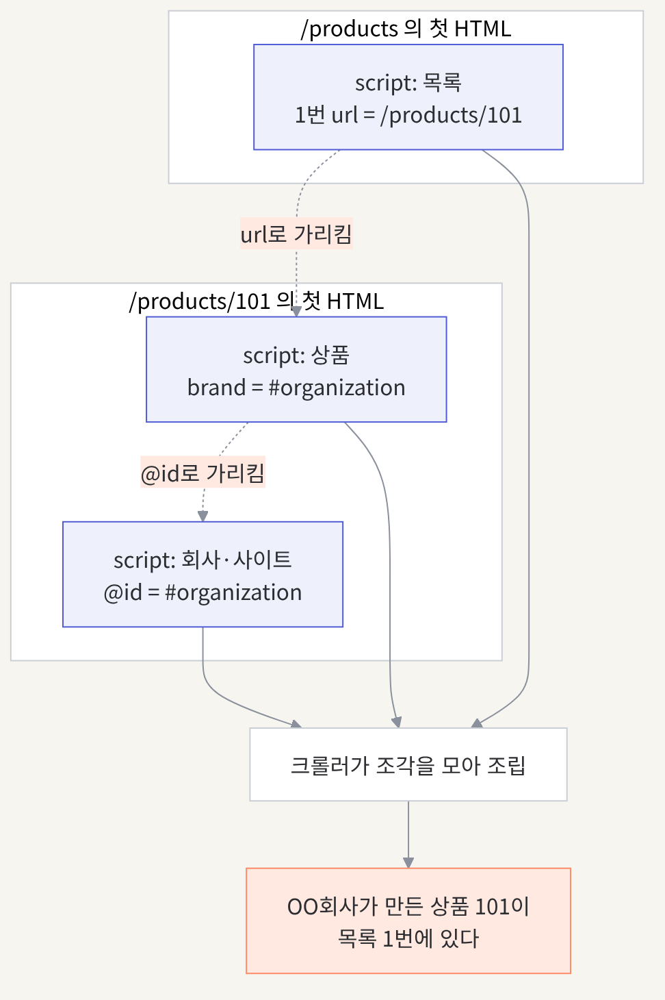
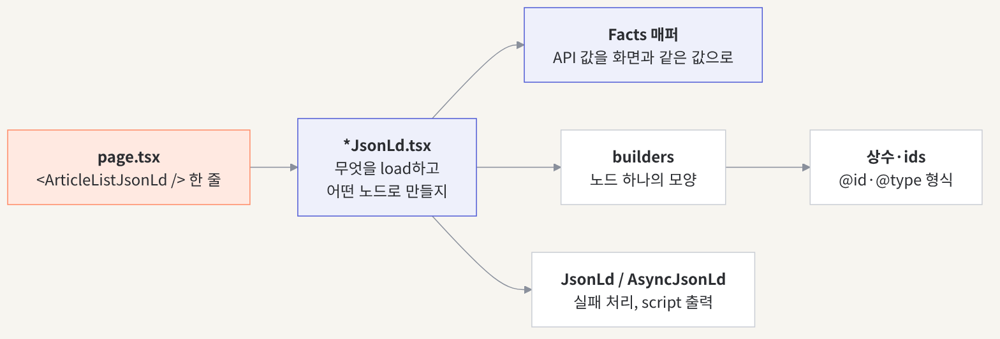
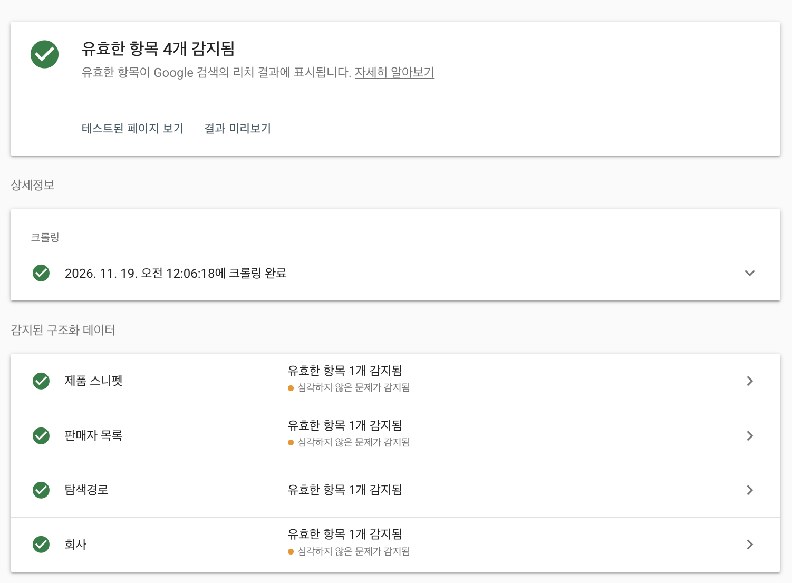
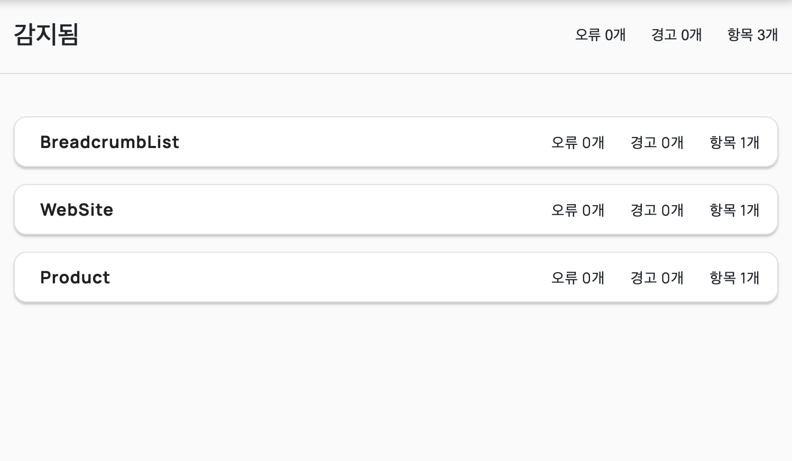

이번 프로젝트는 GEO였어요. GEO(Generative Engine Optimization)는 ChatGPT나 구글 AI 개요 같은 AI 검색이 답을 만들 때, 우리 서비스를 정확히 이해하고 인용하게 만드는 일이에요. SEO가 검색 순위를 다룬다면, GEO는 AI 검색의 답을 다뤄요. 그 방법 중 하나는,
> "JSON-LD 넣기."

여기서 바로 질문이 생겼어요. JSON-LD가 뭔데? 왜 넣어야 하고, 어디에, 어떻게 넣어야 하는 걸까요?
이 글은 그 질문에서 출발해요. JSON-LD가 무엇이고 어떻게 동작하는지 멘탈 모델을 먼저 잡고, 그 멘탈 모델 위에서 코드를 어떤 구조로 짰는지 순서대로 풀어 볼게요.

| 순서 | 질문                                  |
| ---- | ------------------------------------- |
| 1~2  | JSON-LD가 뭔데? 왜 GEO에 도움이 되지? |
| 3    | 어떻게 동작하지? (멘탈 모델)          |
| 4~5  | 그럼 코드는 어떻게 짜야 하지?         |
| 6    | 이게 정말 최선일까?                   |

## 1. JSON-LD가 뭔데?

한 줄로 말하면, **페이지가 무엇에 관한 것인지 기계가 바로 읽을 수 있게 적어 둔 JSON**이에요.

사람은 화면에서 "타입스크립트 기초 49,000원"을 보면 상품 이름과 가격이라는 걸 바로 알아요. 하지만 크롤러에겐 그냥 `<h1>`과 `<span>` 안의 글자라서, 상품 이름인지 카테고리인지, 정가인지 할인가인지 추측해야 해요. JSON-LD는 그 추측을 없애 줘요.

```html
<script type="application/ld+json">
  {
    "@context": "https://schema.org",
    "@type": "Product",
    "name": "타입스크립트 기초"
  }
</script>
```

FE에 익숙한 비유로 나눠 보면 이래요.

| 구분        | 사람용      | 기계용                                                     |
| ----------- | ----------- | ---------------------------------------------------------- |
| 표현        | HTML (UI)   | JSON-LD (API 응답)                                         |
| 단어의 의미 | 눈으로 해석 | schema.org라는 공용 단어장 (`Product`, `name`, `offers` …) |

즉 JSON-LD를 넣는다는 건, **검색엔진들이 함께 정한 단어로 우리 페이지를 자기소개하는 것**이에요.

그런데 기계가 바로 알아들으려면, 쓰는 쪽과 읽는 쪽이 **같은 약속**을 쓰고 있어야 해요. 우리가 마음대로 `"상품명"`이라고 적으면 크롤러는 또 추측해야 하니까요. 그 약속은 두 개로 나뉘어 있어요.

- **단어장 = schema.org.** 구글, Bing, Yahoo, Yandex 같은 검색엔진들이 함께 만든 사전이에요. 그래서 이 데이터를 읽는 쪽은 브라우저가 아니라 검색엔진과 AI 크롤러예요. "상품은 `Product`, 이름은 `name`, 판매 조건은 `offers`, 브랜드는 `brand`"처럼 어떤 단어를 어떤 뜻으로 쓸지 정해 두었어요.
- **문법 = JSON-LD.** 그 단어를 JSON으로 적는 W3C(웹 표준을 정하는 단체) 표준이에요. 일반 JSON에 `@context`, `@type`, `@id`처럼 `@`로 시작하는 키 몇 개만 더해져요.

```jsonc
{
  "@context": "https://schema.org", // 문법: 지금부터 schema.org 단어장을 쓴다
  "@type": "Product", // 문법: 이건 '상품'이다 (Product는 단어장의 단어)
  "@id": "https://example.com/products/101#product", // 문법: 이 상품의 이름표 (3장에서 다시 나와요)
  "name": "타입스크립트 기초", // 단어장: 이름
  "offers": { "@type": "Offer", "price": 49000, "priceCurrency": "KRW" } // 단어장: 가격은 Offer 안에
}
```

정리하면 `@`로 시작하는 키는 문법이고, 나머지 키(`name`, `offers`)와 타입 이름(`Product`, `Offer`)은 단어장의 단어예요. 이 두 가지 약속 덕분에 크롤러는 이 JSON을 추측 없이 해석할 수 있어요. 그래서 실제 작업의 대부분은 문법보다, **schema.org에서 우리 페이지에 맞는 단어를 고르는 일**이에요.

## 2. 왜 GEO에 도움이 될까?

GEO는 ChatGPT, Perplexity, 구글 AI 개요 같은 AI 검색이 우리 서비스를 정확하게 이해하고 답변에 쓰게 만드는 일이에요. AI는 페이지에서 가격, 제공자, 날짜 같은 사실을 뽑아 가는데, 이때 정리된 사실이 있으면 추측할 필요가 줄어들어요.

| 기대할 수 있는 것                                    | 기대하면 안 되는 것           |
| ---------------------------------------------------- | ----------------------------- |
| AI와 검색엔진이 페이지의 사실을 **정확하게 뽑아 감** | "넣으면 AI가 인용한다"는 보장 |
| 회사·서비스·상품의 **관계를 하나로 이해**함          | 검색 순위의 직접적인 상승     |
| 구글 검색 결과의 리치 결과 자격                      | 하루 만에 나타나는 효과       |

그래서 JSON-LD는 "넣으면 바로 효과가 나는 스위치"라기보다, **AI가 우리 서비스를 오해 없이 읽게 하는 기본기**에 가까워요.

## 3. 어떻게 동작할까?

코드를 짜기 전에 잡아야 할 그림은 세 가지예요.

**① 크롤러는 서버가 처음 보낸 HTML만 읽는다.**

웹페이지를 보여 주는 방식은 크게 두 가지예요. 서버가 내용을 다 채운 HTML을 보내는 방식(SSR)과, 빈 HTML을 먼저 보내고 브라우저가 JS를 실행해 내용을 채우는 방식(CSR)이에요. 크롤러가 무엇을 보느냐는 이 차이에서 갈려요. SEO에서 "중요한 내용은 서버에서 그려서 보내라"고 하는 것도 그래서예요.

구글봇은 페이지를 가져오고(크롤링), JS를 실행해 화면을 완성하고(렌더링), 검색용으로 저장해요(색인). 그런데 렌더링은 대기열에 들어갔다가 나중에 해요. 그래서 JS로 넣은 JSON-LD도 결국 읽히지만 늦고, 상품 정보라면 쇼핑 크롤링이 덜 잦고 덜 안정적일 수 있다고 구글이 직접 안내해요. AI 크롤러 대부분은 그 렌더링조차 하지 않아요. 그래서 브라우저에서 실행되는 `useEffect`로 넣은 JSON-LD는 GEO 입장에서는 없는 것과 같아요. → **SSR로, 서버가 보내는 첫 HTML에 넣어야 해요.** ([Google: JavaScript SEO 기본사항](https://developers.google.com/search/docs/crawling-indexing/javascript/javascript-seo-basics), [Google: JavaScript로 구조화된 데이터 생성](https://developers.google.com/search/docs/appearance/structured-data/generate-structured-data-with-javascript))

**② JSON-LD는 한 벌로 묶지 않고 조각으로 보내도 된다. 모으는 건 크롤러다.**

사이트 전체를 하나의 큰 JSON으로 만들 필요가 없어요. 쪼개는 방법은 두 가지예요.

- **페이지마다:** 목록 페이지는 목록을, 상세 페이지는 상품 하나를, 모든 페이지가 공유하는 layout은 회사와 사이트를 설명해요.
- **한 페이지 안에서도:** `<script type="application/ld+json">` 블록을 여러 개 둘 수 있어요. 예를 들어 회사 정보 script 하나, 상품 정보 script 하나처럼요.

크롤러는 이 조각들을 따로 읽은 뒤 자기가 모아서 조립해요.

**③ 크롤러는 조각난 JSON을 `@id`라는 이름표로 이어서 이해한다.**

그럼 따로 보낸 조각이 "같은 회사 얘기"라는 걸 크롤러는 어떻게 알까요? 대상마다 `@id`라는 이름표를 붙이고, 다른 조각에서는 그 이름표만 적어서 가리키면 돼요.

```jsonc
// 조각 A (layout script) — 회사를 정의하고 이름표를 붙인다
{ "@type": "Organization", "@id": "https://example.com/#organization", "name": "OO회사" }

// 조각 B (상품 script) — 회사 내용을 반복하지 않고 이름표만 적는다
{ "@type": "Product", "name": "타입스크립트 기초", "brand": { "@id": "https://example.com/#organization" } }
```

크롤러는 두 조각에서 같은 `@id`를 발견하고 "이 상품의 브랜드는 저 회사"로 이어요. 각 조각을 점(노드)으로, `@id` 참조를 점과 점을 잇는 선으로 보면 돼요. 조각이 늘어날수록 선이 이어져서, 결국 사이트 전체가 하나의 그래프가 돼요.

단, 이름표는 **글자 하나만 달라도 다른 점**이 돼요. `…/#organization`과 `…#organization`은 서로 다른 회사라서 선이 이어지지 않아요.

그런데 가리키는 게 회사나 상품 같은 '대상'이 아니라 '페이지'일 때는, 이름표 대신 페이지 주소를 써요. 기준은 **무엇을 가리키느냐**예요.

| 가리키는 대상          | 연결 방법             | 예                                                              |
| ---------------------- | --------------------- | --------------------------------------------------------------- |
| 대상(회사·사이트·상품) | `@id` (대상의 이름표) | 상품의 `brand` → `…/#organization`                              |
| 페이지                 | `url` (페이지 주소)   | 목록 항목의 `url`, 경로 표시(`BreadcrumbList`) 각 단계의 `item` |

`@id`와 `url`은 비슷해 보여도 가리키는 게 달라요. `…/products/101#product`는 "상품이라는 대상"의 이름표이고, `…/products/101`은 "그 상품을 설명하는 상세 페이지"의 주소예요.

경로 표시(`BreadcrumbList`)도 페이지를 가리키는 쪽이에요. "홈 › 상품 목록 › 타입스크립트 기초"의 각 단계에 화면에 보일 이름(`name`)과 그 단계 페이지의 실제 주소(`item`)를 적어요. 마지막 단계(지금 페이지)는 주소를 생략해도 구글이 현재 페이지 주소를 써요. ([Google: Breadcrumb](https://developers.google.com/search/docs/appearance/structured-data/breadcrumb))

목록 페이지(`ItemList`)도 같은 규칙을 따라요. 구글 가이드는 목록의 각 항목에 상품 정보를 다시 넣지 말고, 상세 페이지 주소(url)와 순서만 적으라고 권해요. "1번은 `/products/101`"처럼요. 자세한 정보는 그 주소의 페이지가 설명하니까요. ([Google: Carousel (ItemList)](https://developers.google.com/search/docs/appearance/structured-data/carousel))



_회사·사이트, 상품, 목록 조각은 따로 있지만 `@id`와 주소로 이어져 하나의 그림이 돼요._

그림에서 점선이 ③의 연결이에요. 점선은 크롤러가 타고 다니는 순서가 아니라 "이 값이 저걸 가리킨다"는 뜻이에요. 크롤러는 목록 페이지든 상세 페이지든 어느 쪽을 먼저 읽어도 되고, 읽은 사실을 쌓아 두었다가 같은 글자(같은 `@id`, 같은 주소)를 만나면 이어 붙여요. 조각은 페이지 사이에도, 한 페이지 안에도 있지만, 연결은 이름표와 주소가 만들어요.

그리고 세 가지를 관통하는 사실이 하나 더 있어요. **JSON-LD는 사용자 눈에 보이지 않고, 페이지의 기능과도 상관이 없다.** 여기서부터 설계 고민이 시작돼요.


## 4. 멘탈 모델에서 나온 설계 원칙

JSON-LD는 공개 페이지라면 거의 다 붙어야 하지만, 페이지가 사용자에게 주는 기능과는 상관이 없어요. 로깅처럼 **어디에나 붙지만 비즈니스 로직은 아닌 관심사**예요.

저는 이런 관심사를 다룰 때 이런 방향을 추구해요.

- 페이지 코드를 읽을 때 **비즈니스 로직만 보여야** 한다.
- 페이지를 만드는 사람이 **알아야 하는 지식을 최소로** 한다.
- "어떻게"는 숨기고 **"무엇을"만 선언**하게 한다.

이런 관심사는 보통 **정책을 얇은 래퍼(wrapper)나 작은 공용 모듈(이하 '틀')에 모아 두고, 쓰는 쪽은 인자만 넘기는** 방식으로 다뤄요. NestJS의 데코레이터나 Express의 미들웨어가 같은 발상이에요. 호출하는 쪽은 "무엇을"만 알고, 공통 정책은 한 곳에서 바뀌어요. 로깅은 어디서나 "봤다/눌렀다"로 하는 일이 같아서, 틀 안의 내용까지 거의 정해져 있어요.

JSON-LD는 사정이 조금 달라요. 틀로 만들 수 있는 부분과 없는 부분이 나뉘어요. 아래 표의 **Facts 매퍼**는 API 응답을 화면에 보이는 값으로 정리하는 변환 함수예요.

|         | 틀로 만들 수 있음 (공통)                                                      | 틀로 만들 수 없음 (인자)                                                         |
| ------- | ----------------------------------------------------------------------------- | -------------------------------------------------------------------------------- |
| 무엇    | 실패 처리, script 출력, `@id` 규칙, 회사 정보                                 | 무엇을 가져와 어떤 노드로 만들지                                                 |
| 이유    | 어느 페이지든 똑같다                                                          | 페이지마다 다르고, 그 내용이 곧 도메인 지식이다 (공지는 Article, 상품은 Product) |
| 실제 예 | `@type`·`@id` 상수, `<` 이스케이프(`</script>` 주입 방지), 상품 이미지 기본값 | Facts 매퍼: 화면과 같은 방식으로 가격·설명·대표 이미지를 고르는 규칙             |

그럼 내용까지 틀에 넣으면 안 될까요? 양쪽 끝을 나란히 놓아 보면 답이 보여요.

- **틀이 없으면:** 페이지마다 회사 정보, `@context` 같은 문법, 실패 처리를 복사해요.
- **내용까지 틀에 넣으면:** 틀이 페이지 종류마다 다른 규칙(가격을 어떻게 계산할지, 설명으로 무엇을 쓸지 등)을 전부 알아야 하고, 페이지가 늘 때마다 틀 안에 분기가 쌓여요.

그래서 공통인 것만 틀에 두고, 페이지마다 다른 내용은 인자로 넘기기로 했어요. 기준을 한 줄로 하면 **"무엇을 고를지"는 인자, "고른 걸 어떻게 만들지"는 틀**이에요. 목표를 한 문장으로 하면 이래요.

> **숨길 수 있는 것은 모두 숨기고, 숨길 수 없는 내용은 선언만 남긴다.**

멘탈 모델을 여기에 대입하면 설계 원칙이 자연스럽게 나와요.

| 멘탈 모델 / 사실                                    | 설계 원칙                                                          |
| --------------------------------------------------- | ------------------------------------------------------------------ |
| ① SSR HTML에 있어야 읽힌다                          | **서버 컴포넌트로만 출력한다**                                     |
| ② 조각으로 보내도 된다 (한 페이지에 script 여러 개) | **script 경계 = 실패 경계.** LD 하나가 실패해도 그 script만 빠지게 |
| ② 페이지마다 자기 조각을 낸다                       | **이 URL의 LD는 라우트 옆 한 파일에서 찾는다** (파일 위치)         |
| ③ `@id`는 글자 하나만 달라도 끊긴다                 | **규칙(`@id`, 노드 모양)은 한 곳에서 만든다**                      |
| 페이지마다 내용이 다르다                            | **내용은 페이지가 안다** (공통 코드에 페이지별 분기를 쌓지 않는다) |
| 사용자에게 보이지 않는 부가 기능이다                | **LD가 실패해도 화면은 살아 있어야 한다**                          |


## 5. 그래서 이렇게 만들었어요

### 페이지 하나의 HTML에는 script가 최대 세 개

| script                        | 담는 것                                                                 | 어디서               | 실패하면            |
| ----------------------------- | ----------------------------------------------------------------------- | -------------------- | ------------------- |
| ① 사이트 identity             | 회사 + 웹사이트 (`@id` 정의)                                            | layout               | ①만 빠짐            |
| ② 페이지 의미                 | 목록 페이지: WebPage + Breadcrumb / 상세 페이지: 상품·공지 + Breadcrumb | 라우트 `*JsonLd.tsx` | 이 script만 빠짐    |
| ③ 하위 항목 (목록 페이지에만) | ItemList (상세 페이지 url들)                                            | 라우트 `*JsonLd.tsx` | ③만 빠지고 ②는 남음 |

②는 "이 페이지가 무엇인가"예요. 목록 페이지는 "이건 상품 목록 페이지예요"(WebPage)라고 소개하고, 상세 페이지는 "이 페이지의 주인공은 이 상품·이 공지예요"(Product·Article)라고 소개해요. 목록 페이지에도 API가 필요한 부분(항목 url들)이 있는데, 그 부분만 ③으로 떼어냈어요. 그래서 목록 API가 실패해도 ③만 빠지고 ②는 항상 나가요. 상세 페이지는 ①② 2개, 목록 페이지는 ①②③ 3개예요.

### 코드는 "누가 무엇을 아는가"로 나눴어요



_페이지는 한 줄만 알고, 나머지는 아래 층이 하나씩 맡아요._

| 층                       | 아는 것                                                              | 모르는 것                    |
| ------------------------ | -------------------------------------------------------------------- | ---------------------------- |
| `page.tsx`               | 이 페이지에 LD가 있다는 것 (한 줄)                                   | LD의 내용, 실패 처리         |
| `*JsonLd.tsx`            | 무엇을 가져와 어떤 노드로 만들지 (인자)                              | try/catch, script 태그, 환경 |
| Facts 매퍼               | API 값을 화면과 같은 값으로 바꾸는 규칙 (인자)                       | schema 모양                  |
| builders                 | 노드 하나의 모양 (틀)                                                | 데이터 출처, 실패            |
| 상수·ids                 | `@id`·`@type` 형식, 절대 주소 규칙 (틀)                              | 어떤 페이지인지              |
| `JsonLd` / `AsyncJsonLd` | 실패하면 script를 빼고 로그를 남긴다, production에서만 출력한다 (틀) | 어떤 schema인지              |

Facts 매퍼를 따로 둔 이유는, 구조화 데이터가 화면에 보이는 내용과 달라서는 안 되기 때문이에요. 가격이라면 화면과 같은 할인 계산을 거쳐요. 크롤러에게 하는 소개가 화면과 다르면 오히려 신뢰를 잃어요.

### 사용하는 모습

바깥에서부터 볼게요. 아래 코드는 실제 구조를 그대로 따르되, 이름과 경로는 일반화한 단순화 예시예요.

페이지에서 보이는 LD는 한 줄이에요.

```tsx
// app/(main)/articles/page.tsx
// 페이지는 본문만 그리고, LD는 한 줄로 붙인다.
export default async function ArticleListPage() {
  const articles = await getArticles(); // 본문용 조회 (LD와 별개)

  return (
    <>
      <ArticleListJsonLd />
      <ArticleList articles={articles} />
    </>
  );
}
```

`page.tsx`는 LD가 있다는 사실만 알고, 내용과 실패 처리는 몰라요. 그 한 줄을 열면, 라우트 옆 `*JsonLd.tsx`에는 "무엇을"만 있어요.

```tsx
// app/(main)/articles/ArticleListJsonLd.tsx
// 목록 페이지 = script 두 개.
// ② 페이지 의미(동기, 항상 출력) + ③ 하위 항목(비동기, 실패하면 이것만 빠짐)
export function ArticleListJsonLd() {
  return (
    <>
      {/* ② 이 페이지가 무엇인가: 상수만으로 만들 수 있어 API가 필요 없다 */}
      <JsonLd
        logLabel={JSON_LD_LABEL.articleList}
        buildDocument={() =>
          composeGraph(
            webPageNode({
              path: ARTICLE_LIST_PATH,
              name: ARTICLE_LIST_TITLE,
              description: ARTICLE_LIST_DESCRIPTION,
            }),
            breadcrumbListNode(
              trailFromHome([
                { name: ARTICLE_LIST_TITLE, path: ARTICLE_LIST_PATH },
              ]),
            ),
          )
        }
      />

      {/* ③ 하위 항목: 상세 페이지 url 목록. API가 필요하다 */}
      <AsyncJsonLd
        logLabel={JSON_LD_LABEL.articleList}
        load={loadArticleItemUrls} // 상세 페이지 url 배열을 돌려준다
        toGraph={(itemUrls) => {
          const itemList = itemListNode({ path: ARTICLE_LIST_PATH, itemUrls });
          return itemList ? composeGraph(itemList) : undefined; // 빈 목록이면 script 생략
        }}
      />
    </>
  );
}
```

②와 ③을 나눈 이유는 하나예요. 목록 API가 실패해도 ③만 빠지고 ②는 남게 하려고요.

상세 페이지는 데이터가 있어야 노드를 만들 수 있어서, 비동기 script 하나예요.

```tsx
// app/(main)/articles/[id]/ArticleDetailJsonLd.tsx
// 상세 페이지 = script 하나(비동기). 데이터가 있어야 노드를 만들 수 있다.
export function ArticleDetailJsonLd({ id }: { id: number }) {
  return (
    <AsyncJsonLd
      logLabel={JSON_LD_LABEL.articleDetail}
      load={() => getArticle(id)} // 없으면 undefined → 로그 없이 생략
      toGraph={(article) => {
        const facts = toArticleFacts(article); // 화면과 같은 값으로 정리
        return composeGraph(
          articleNode(facts),
          articleBreadcrumbListNode(facts),
        );
      }}
    />
  );
}
```

세 파일 어디에도 try/catch가 없어요. 페이지가 넘기는 건 데이터가 아니라 **함수**예요. `JsonLd`에는 `buildDocument` 하나, `AsyncJsonLd`에는 `load`와 `toGraph` 두 개를 넘기고, 실행 시점과 실패 처리는 틀이 정해요. React Query에서 `queryFn`과 `select`만 넘기면 호출과 에러 상태는 라이브러리가 맡는 것과 같은 모양이에요.

| 넘기는 것       | 답하는 질문                           | 비슷한 것     |
| --------------- | ------------------------------------- | ------------- |
| `load`          | 무엇을 가져올까?                      | `queryFn`     |
| `toGraph`       | 가져온 걸 어떤 노드로 만들까?         | `select`      |
| `buildDocument` | (API 없이) 어떤 노드로 만들까?        |               |
| `logLabel`      | 깨지면 로그에 어느 페이지라고 남길까? | 로그용 이름표 |

`AsyncJsonLd`는 `load()`를 실행하고, 결과를 `toGraph()`에 넣고, 성공하면 script로 출력해요. 단계마다 결과는 이렇게 갈려요.

| 상황                                    | 결과                                       | 로그 (예: 공지 상세)             | 주로 의심할 곳  |
| --------------------------------------- | ------------------------------------------ | -------------------------------- | --------------- |
| `load` 실패                             | script를 빼고 화면은 그대로                | `[json-ld:article-detail:load]`  | 데이터·API 문제 |
| `toGraph` 실패                          | script를 빼고 화면은 그대로                | `[json-ld:article-detail:build]` | 우리 코드 버그  |
| 결과가 비어 있음 (데이터 없음, 빈 목록) | script만 생략                              | 없음                             | 정상            |
| 둘 다 성공                              | `<script type="application/ld+json">` 출력 | 없음                             |                 |

이 실패 처리는 `loadSafely`(가져오기)와 `buildSafely`(만들기) 두 **함수**에만 있고, `JsonLd`·`AsyncJsonLd` **컴포넌트**가 안에서 이 함수들을 불러요. 로그 형식은 `[json-ld:<페이지 라벨>:<단계>]`라서, 로그만 보고 어디서 깨졌는지 알 수 있어요.

하나 더, 본문 조회(`getArticles`)와 LD 조회(`loadArticleItemUrls`)는 일부러 따로 했어요. 한쪽 실패가 다른 쪽에 섞이지 않게 하려고요. 대신 같은 데이터를 두 번 요청할 수 있다는 비용을 받아들였어요.

`AsyncJsonLd`는 `Suspense`로 감싸서, 페이지는 먼저 보내고 LD는 준비되는 대로 같은 HTML 응답 뒤쪽에 이어서 보내요. 그래서 페이지 응답은 늦어지지 않고, script도 서버가 보내는 HTML 안에 들어 있어요.

그리고 LD는 production 환경에서만 출력돼요(`isJsonLdEnabled()`). 개발 서버 HTML에는 script가 없고, 노드를 만드는 함수도 호출되지 않아요. 이 확인도 틀 안에서 해서, 페이지를 만드는 사람은 환경을 몰라도 돼요.

### 새 페이지에 붙인다면

1. 라우트 폴더에 `*JsonLd.tsx`를 하나 만들어요.
2. API가 필요 없으면 `JsonLd`, 필요하면 `AsyncJsonLd`에 "무엇을"만 넘겨요.
3. `page.tsx`에 한 줄 붙이고, 리치 결과 테스트로 확인해요.

실패 처리, `@id` 규칙, 회사 정보, 개발 서버 차단은 이미 틀이 해 줘요. 신경 쓸 건 "이 페이지가 무엇인가" 하나예요. 단, 화면과 다른 값은 넣지 않아요.

### 실제로 확인하기

붙인 결과는 도구로 바로 확인할 수 있어요.

- [Rich Results Test](https://search.google.com/test/rich-results): 운영 URL을 넣으면 구글이 인식한 항목(Product, Breadcrumb 등)을 보여 줘요. 코드 입력은 JS 실행에 제한이 있어서 URL 입력으로 확인하는 게 정확해요.
- [Schema Markup Validator](https://validator.schema.org): 구글 기능과 상관없이 schema.org 문법만 검사해요.
- 페이지 소스 보기: 상품 상세 페이지 HTML에는 `application/ld+json` script가 2개(회사·사이트, 상품·경로) 들어 있어요. 따로 있지만 `#organization` 이름표로 하나의 그래프로 인식돼요.



_리치 결과 테스트에서 구글이 인식한 항목이에요._


_Schema Markup Validator에서 인식한 항목이에요._


## 6. 이게 정말 최선일까?

4장에서 세운 기준으로 스스로 점검해 봤어요.

| 기준                            | 스스로 보기엔 | 근거                                                               |
| ------------------------------- | ------------- | ------------------------------------------------------------------ |
| 페이지 코드에는 비즈니스 로직만 | 잘 됨         | `page.tsx`에는 `<…JsonLd />` 한 줄                                 |
| 알아야 하는 지식 최소화         | 대체로 됨     | 실패 처리, `@id`, 회사 정보, 로그 라벨 형식, 환경 구분은 숨겨짐    |
| "무엇을"만 선언                 | 절반          | `load`·`toGraph`는 직접 써야 함. 단, 이건 내용이라 의도적으로 남김 |
| 실패해도 화면은 살아 있음       | 됨            | load와 build 모두 safe 함수 안에서 실행                            |
| 개발 서버에 노출되지 않음       | 됨            | production에서만 출력                                              |
| 깜빡해도 잡힐까                 | 아직          | 새 URL에 LD를 빠뜨리면 지금은 리뷰가 유일한 안전장치               |

### **잘된 것, 받아들인 것, 남은 것**

- **잘 된 점:** 비즈니스와 무관한 것(실패 처리, script, `@id`, 회사 정보)은 숨기고, 페이지마다 다른 것(내용)만 남겼어요. 그래서 `page.tsx`에는 한 줄만 남고, `*JsonLd.tsx`에는 try/catch가 없어요.
- **받아들인 점:** 내용을 선언하는 수고는 남아요. 이걸 더 줄이려면 내용을 공통 코드로 옮겨야 하는데, 그러면 공통 코드가 모든 페이지의 사정을 알아야 하고 페이지가 늘 때마다 분기가 쌓여요.
- **남은 점:** 누락을 장치가 잡아 주지 않아요. sitemap에 있는 URL을 기준으로 검사하는 방식을 후속으로 검토 중이에요.

### **마치며**

정리하면, JSON-LD는 크롤러를 위한 자기소개서이고, 로깅처럼 비즈니스와는 상관없는 관심사였어요. 그래서 비즈니스 코드와 떼어 내고, 페이지마다 반복되는 보일러플레이트는 틀로 줄이되, 페이지마다 다른 내용은 페이지가 직접 선언하는 구조를 고민했어요. 목표는 누가 새 페이지에 JSON-LD를 붙이더라도 "이 페이지가 무엇인가"만 선언하면 바로 붙일 수 있는 구조예요. 지금은 이 구조가 최선이라고 판단하지만, 실제로 페이지를 더 붙여 보면서 틀에 둘 것과 페이지에 둘 것의 경계를 다시 확인해 나갈 생각이에요.
